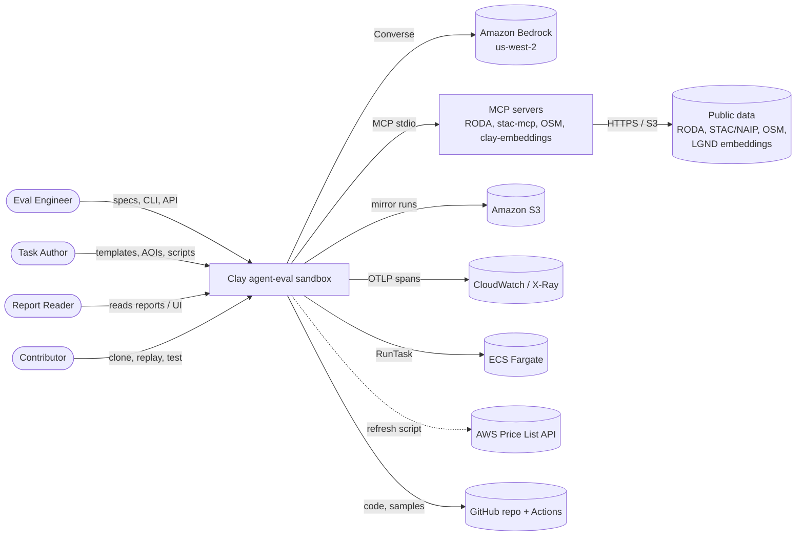
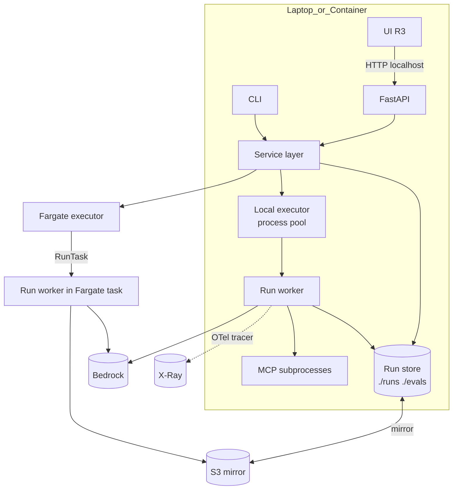
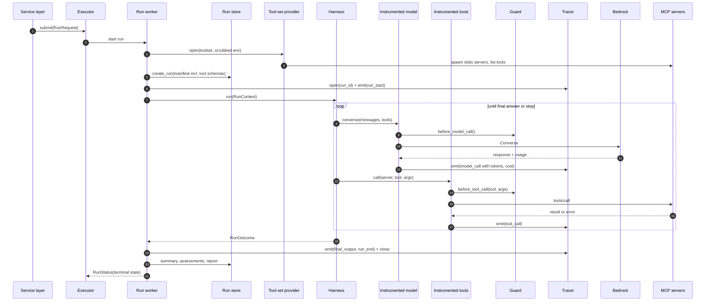
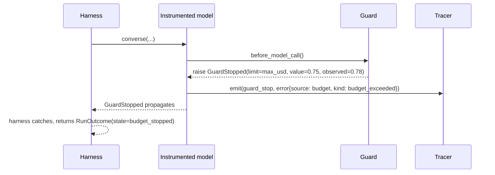
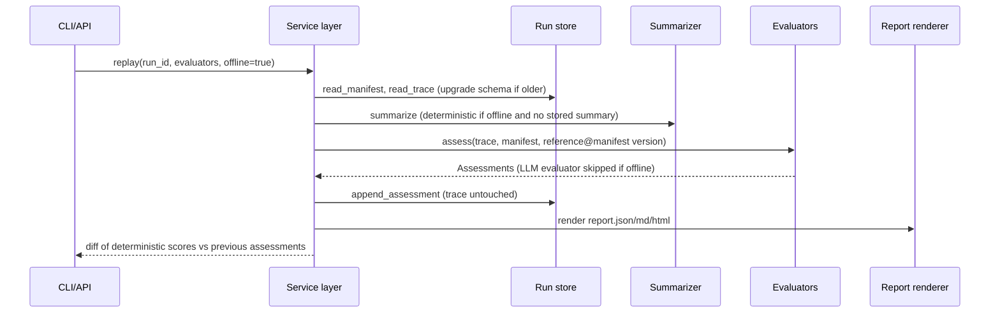
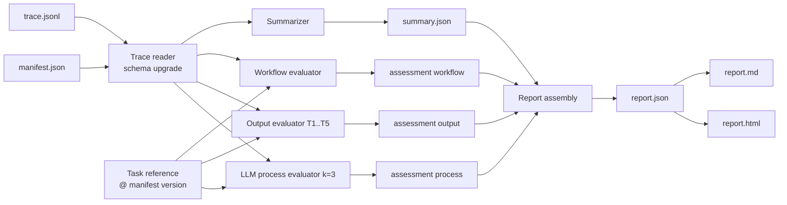
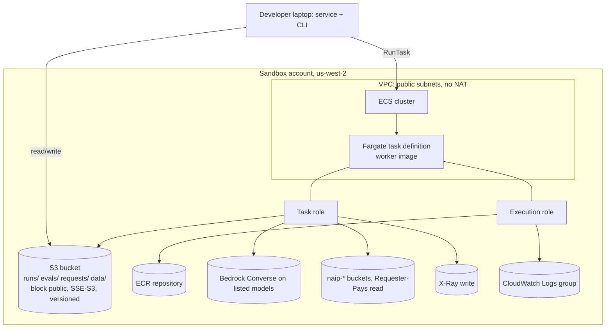
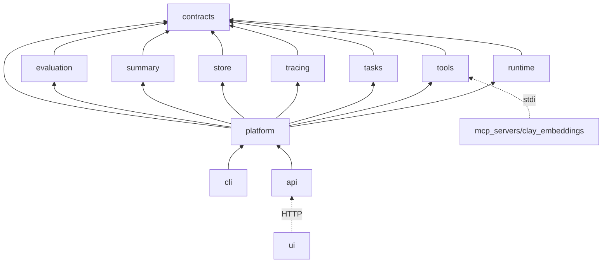

# Architecture — Clay Agent-Eval Sandbox

> **For agents — what this file is:** The architecture that satisfies [srs.md](srs.md). It defines the parts of the system, how they connect, which parts are fixed and which are meant to change, the contracts the five workstreams build against, the runtime flows, storage, deployment, security and testing. Every structural choice links to an entry in [design-decisions.md](design-decisions.md). Requirements are cited by ID (FR-x.y, NFR-…, ASR-…). Code blocks are contract sketches: field names and method signatures are the agreed shape, to be finalised in `claysandbox/contracts/` in the first hour of R0 and frozen after that (DD-005).

| Field | Value |
|---|---|
| Version | 1.0 |
| Date | 2026-11-03 |
| Status | Baseline for `plan.md` |
| Based on | srs.md v1.0, DD-001 to DD-043 |

## Contents

1. [Architecture principles](#1-architecture-principles)
2. [System context](#2-system-context)
3. [Containers](#3-containers)
4. [Components and workstream ownership](#4-components-and-workstream-ownership)
5. [Fixed core and changing parts](#5-fixed-core-and-changing-parts)
6. [Connected parts: integration map](#6-connected-parts-integration-map)
7. [Contracts](#7-contracts)
8. [Runtime flows](#8-runtime-flows)
9. [Instrumentation, guards and error handling](#9-instrumentation-guards-and-error-handling)
10. [Scoring pipeline](#10-scoring-pipeline)
11. [Statistics and comparisons](#11-statistics-and-comparisons)
12. [Cost model](#12-cost-model)
13. [Storage](#13-storage)
14. [Task library](#14-task-library)
15. [The clay-embeddings MCP server](#15-the-clay-embeddings-mcp-server)
16. [API and CLI layer](#16-api-and-cli-layer)
17. [Deployment](#17-deployment)
18. [Security](#18-security)
19. [Observability of the sandbox](#19-observability-of-the-sandbox)
20. [Dependencies](#20-dependencies)
21. [Repository layout](#21-repository-layout)
22. [Testing and CI](#22-testing-and-ci)
23. [Workstream deliverables per release](#23-workstream-deliverables-per-release)
24. [Risks, technical debt and evolution](#24-risks-technical-debt-and-evolution)

---

## 1. Architecture principles

| # | Principle | What it means in practice | Source |
|---|---|---|---|
| P1 | **The trace is the truth** | Summaries, scores, statistics and reports read only the trace, manifest and task reference. Never harness internals | ASR-01, DD-011 |
| P2 | **Runs are immutable, assessments accumulate** | Nothing rewrites a trace or manifest after `run_end`. Re-scoring adds files | ASR-02, DD-018 |
| P3 | **Everything that varies is a plugin** | Models, harnesses, tracers, evaluators, tool sets, executors, stores are registry entries chosen by name | ASR-03, DD-021 |
| P4 | **Contracts before code** | Five developers build in isolation against frozen interfaces, fakes and conformance tests | ASR-04, DD-005, DD-035 |
| P5 | **Local first, cloud additive** | Replay, scoring, stats and reports need no AWS. AWS adds Bedrock, S3 mirror, X-Ray, Fargate | ASR-05, DD-006 |
| P6 | **Instrument at the boundary** | Tracing and guards wrap the model adapter and the tool session, so every harness is traced and guarded the same way | §9 |
| P7 | **Measurement apart from the measured** | Evaluators and tracers are compared on identical runs, never through new agent runs | ASR-07, DD-026 |
| P8 | **Least privilege for untrusted tools** | MCP servers start with a scrubbed environment and pinned versions | ASR-08, DD-034 |
| P9 | **Know the cost first** | Every eval is estimated before launch. Every model call is priced at trace time | ASR-09, DD-013 |

---

## 2. System context



The sandbox has no inbound network exposure in the MVP: the API binds to localhost (DD-034).

---

## 3. Containers

| Container | Technology | Responsibility | Runs where |
|---|---|---|---|
| **CLI** `clay-sandbox` | Python 3.12, Typer-style CLI | User entry point. Calls the service layer | Laptop, Docker |
| **API** | FastAPI + Uvicorn | HTTP entry point. Calls the same service layer. Publishes OpenAPI, schema and registry | Laptop, Docker |
| **Service layer** | Python | Composition root: validates specs, expands run plans, estimates, schedules runs on an executor, triggers scoring and stats | In-process with CLI or API |
| **Run worker** | Python (same package) | Executes one run: manifest → tool set → harness → trace → summary → assessments → report | Local process pool, or a Fargate task |
| **MCP servers** | Third-party (`uvx`) and our `clay-embeddings` | Tools for the agent | Subprocesses of the run worker |
| **Run store** | Files (JSON/JSONL), optional S3 mirror, DuckDB for queries | Durable runs, assessments, reports | Local disk, S3 |
| **UI** (R3) | React + Vite + TypeScript, generated API client | Browser front end over the API | Laptop (static build) |
| **Infrastructure** | AWS CDK (Python) | S3, ECR, ECS, IAM, CloudWatch Logs | Sandbox account |



---

## 4. Components and workstream ownership

Workstreams and developers per DD-044: WS1 Prithwish, WS2 Vishal, WS3 Shivaani, WS4 Barath, WS5 5th member. Every component imports only `contracts` and third-party libraries, except the composition root (`platform.service`) and the entry points (`cli`, `api`) (DD-020).

| Package | Component | Owner | Implements | Release |
|---|---|---|---|---|
| `contracts` | Schemas, interfaces, registry, errors, fakes, conformance suites | All (frozen after R0 hour 1) | — | R0 |
| `runtime.models` | Bedrock model adapter (Converse) | WS1 | `ModelAdapter` | R0 |
| `runtime.harness.strands` | Strands harness | WS1 | `Harness` | R0 |
| `runtime.harness.converse_loop` | Plain Converse tool loop | WS1 | `Harness` | R1 built, R2 registered |
| `runtime.instrument` | Instrumented model adapter and tool session (tracing + guards) | WS1 | wraps `ModelAdapter`, `ToolSession` | R0 |
| `runtime.guard` | Budget guard, loop guard | WS1 | `BudgetGuard` | R1 (loop), R2 (full) |
| `runtime.pricing` | Price table loader, refresh script | WS1 | `PriceTable` | R1 |
| `tools` | Tool-set loader, MCP stdio launcher, env scrubbing, capability map | WS2 | `ToolSetProvider`, `ToolSession` | R0 |
| `tasks` | Template loader, instantiation, reference builders, reference versioning | WS2 | `TaskLibrary` | R0–R2 |
| `mcp_servers/clay_embeddings` | Embeddings MCP server + staging script | WS2 | MCP server | R2 |
| `tracing` | JSONL tracer, OTel tracer, tee tracer, redaction | WS3 | `Tracer` | R0 (JSONL), R2 (OTel, tee) |
| `store` | Local store, S3 mirror, DuckDB queries, trace reader with version upgrade | WS3 | `RunStore` | R0–R2 |
| `summary` | LLM summarizer, deterministic summarizer, citation checker | WS3 | `Summarizer` | R1 |
| `samples` (data) | Sample runs, planted traces | WS3 | — | R1–R2 |
| `evaluation.workflow` | Deterministic workflow evaluator | WS4 | `Evaluator` | R1 |
| `evaluation.output` | Output metric evaluators per template | WS4 | `Evaluator` | R1 (T1, T2, T5), R2 (T3, T4) |
| `evaluation.llm_process` | LLM process evaluator | WS4 | `Evaluator` | R2 |
| `evaluation.stats` | Statistics | WS4 | `StatsEngine` | R2 |
| `evaluation.compare` | Agent-axis comparison, evaluator comparison | WS4 | — | R2 |
| `tracing.compare` | Tracer comparison from tee-tracer data | WS3 | — | R2 |
| `evaluation.validate` | Planted-trace validation | WS4 | — | R2 |
| `runtime.estimate` | Pre-flight cost estimate | WS1 | `CostEstimator` | R2 |
| `scripts/live_journeys.sh`, `tests/live/` | Live journey runs for release gates | WS4 | — | R1–R2 |
| `platform.registry_bootstrap` | Imports all plugin modules so they register | WS5 | — | R0 |
| `platform.service` | Composition root, orchestration | WS5 | — | R0–R2 |
| `platform.executors.local` | Local executor, infra retries | WS5 | `Executor` | R0 (local), R1 (retries) |
| `platform.executors.fargate` | Fargate executor | WS1 | `Executor` | R2 (Should) |
| `platform.reports` | Report JSON assembly, Markdown and HTML renderers | WS5 | `ReportRenderer` | R1 |
| `cli`, `api` | Entry points | WS5 | — | R0 (CLI run), R2 (API) |
| `docker/`, `infra/` | Docker image, CDK app | WS1 | — | R2 |
| `ui/` | React app: shell, client and New Run by WS5. One screen each by WS2 (Runs), WS3 (Report), WS4 (Comparison) | WS5 + all | — | R3 |

### 4.1 Import rules (enforced by import-linter, DD-020)

```
contracts            → (pydantic, stdlib only)
runtime, tools, tasks, tracing, store, summary, evaluation
                     → contracts (+ their own third-party libs)
platform             → contracts + every component package   (composition root)
cli, api             → platform
mcp_servers/*        → nothing in claysandbox (standalone servers)
ui/                  → generated API client only
```

Forbidden examples: `evaluation` importing `runtime`, `tracing` importing `store`, `runtime` importing `tasks`. When one component needs another's data, it gets it as a contract object passed in by `platform.service`.

---

## 5. Fixed core and changing parts

### 5.1 Fixed core (changes need a new DD entry and a version bump)

| Part | Why it's fixed | Version field |
|---|---|---|
| `TraceEvent` schema | Replay, re-scoring and tracer swaps depend on it | `schema_version` |
| `RunManifest` schema | Provenance (SC7) | `schema_version` |
| `Assessment` schema | Reports and stats read it | `schema_version` |
| `Report` JSON schema | Markdown, HTML and UI all read it | `schema_version` |
| `EvalSpec` schema | CLI, API and UI all build it | `spec_version` |
| `TaskTemplate` / `TaskReference` / workflow spec schema | WS2 writes, WS4 reads | `schema_version` |
| Interfaces in `contracts.interfaces` | Five workstreams build against them | package version |
| Run lifecycle states (srs §8.3) | Executor, stats and reports agree on them | — |
| Store layout (§13) | Local, S3, git samples and replay all use it | `store_layout_version` |
| Registry mechanism | All plugins use it | — |

### 5.2 Changing parts (variability points, selected in the eval spec)

| Variability point | Registry kind | MVP implementations | Adding one requires | Comparison axis? |
|---|---|---|---|---|
| Model | `model` | `bedrock` adapter with any model ID (Nova Lite, Nova Pro, Sonnet-class, judge model) | Nothing (config) for Bedrock models. New adapter for non-Bedrock | Yes (agent) |
| Harness | `harness` | `strands`, `converse_loop` | Class implementing `Harness` + conformance pass | Yes (agent) |
| Tool set | `toolset` | `T0`, `T1` (+ optional `lgnd`) | YAML file in `toolsets/` + capability map | Yes (agent) |
| Tracer | `tracer` | `jsonl`, `otel`, `tee` | Class implementing `Tracer` + conformance pass | Yes (measurement) |
| Evaluator | `evaluator` | `workflow@1`, `output.t1..t5@1`, `llm_process@1` | Class implementing `Evaluator` + planted-trace validation | Yes (measurement) |
| Summarizer | `summarizer` | `llm`, `deterministic` | Class implementing `Summarizer` | No |
| Executor | `executor` | `local`, `fargate` | Class implementing `Executor` | No |
| Run store | `store` | `local`, `local+s3` | Class implementing `RunStore` | No |
| Task templates and AOIs | data | T1–T5, 6 AOIs | YAML + reference builder script | No (they're the test set) |
| Price table | data | `pricing/prices.yaml` | Refresh script or edit, new version | No |
| Stats parameters | spec fields | N, seed, bootstrap iterations, alpha | Config | No |

---

## 6. Connected parts: integration map

| From | To | What flows | Contract | Sync/async |
|---|---|---|---|---|
| CLI / API | Service layer | EvalSpec, commands | `EvalSpec`, service methods | Sync call, async eval |
| Service layer | Task library | Template + AOI → task instances + references | `TaskInstance`, `TaskReference` | Sync |
| Service layer | Estimator | Run plan + history → estimate | `CostEstimate` | Sync |
| Service layer | Executor | Run plan items | `RunRequest` | Async |
| Executor | Run worker | One `RunRequest` | `RunRequest` | Process / Fargate task |
| Run worker | Tool-set provider | Tool set name → live `ToolSession` | `ToolSession` | Async (MCP) |
| Run worker | Harness | `RunContext` | `Harness.run` | Sync (harness may use asyncio inside) |
| Harness | Instrumented model adapter | Messages, tools → response | `ModelAdapter` | Sync |
| Harness | Instrumented tool session | Tool calls → results | `ToolSession` | Async |
| Instrumented wrappers | Tracer | `TraceEvent`s | `Tracer` | Sync, append |
| Instrumented wrappers | Budget guard | Usage → allow / stop | `BudgetGuard` | Sync |
| Run worker | Run store | Manifest, trace path, summary, assessments, report | `RunStore` | Sync |
| Summarizer | Model adapter (uninstrumented, evaluation cost) | Trace digest → narrative | `ModelAdapter` | Sync |
| Evaluators | — | Trace + manifest + reference → Assessment | `Evaluator` | Sync, pure |
| Stats engine | Run store (DuckDB) | Assessments of an eval → statistics | `StatsResult` | Sync |
| Report renderer | Run store | Report JSON → md/html | `Report` | Sync |
| OTel tracer | CloudWatch/X-Ray | OTLP spans | OTel GenAI mapping | Async batch export |
| Store | S3 | Run folders | Store layout | Async mirror |
| UI | API | JSON over HTTP, SSE | OpenAPI | Async |

---

## 7. Contracts

All contracts live in `claysandbox/contracts/` as Pydantic v2 models and `typing.Protocol` interfaces. Sketches below. The R0 contracts session turns them into code.

### 7.1 Trace events (DD-011)

```python
# contracts/trace.py
from datetime import datetime
from typing import Annotated, Literal, Union
from pydantic import BaseModel, Field

SCHEMA_VERSION = "1.0"

class ErrorInfo(BaseModel):
    source: Literal["agent", "tool", "budget", "infra"]
    kind: str                     # taxonomy in srs §12.4
    message: str
    retryable: bool = False
    related_event_id: str | None = None

class _Base(BaseModel):
    schema_version: str = SCHEMA_VERSION
    run_id: str
    seq: int                      # 0..n, strictly increasing
    event_id: str                 # f"{run_id}:{seq}"
    parent_id: str | None = None  # e.g. tool_call -> model_call that requested it
    ts_start: datetime
    ts_end: datetime | None = None
    latency_ms: float | None = None
    error: ErrorInfo | None = None

class RunStart(_Base):
    type: Literal["run_start"] = "run_start"
    task_instance_id: str
    config_name: str

class ModelCall(_Base):
    type: Literal["model_call"] = "model_call"
    model_id: str
    input_tokens: int
    output_tokens: int
    stop_reason: str | None
    tool_use_requests: list[dict]          # tool name + args the model asked for
    text_preview: str | None
    cost_usd: float
    price_table_version: str

class ToolCall(_Base):
    type: Literal["tool_call"] = "tool_call"
    server: str
    tool: str
    capability: str | None                 # from the tool set's capability map
    args: dict
    status: Literal["ok", "error", "timeout", "rejected"]
    result_preview: str | None
    result_ref: str | None                 # "blobs/<sha256>" for full result
    result_sha256: str | None
    cost_usd: float = 0.0

class GuardStop(_Base):
    type: Literal["guard_stop"] = "guard_stop"
    limit: Literal["max_steps", "max_tokens", "max_usd", "max_seconds", "loop"]
    limit_value: float
    observed_value: float

class ErrorEvent(_Base):                    # errors not attached to a call
    type: Literal["error"] = "error"

class FinalOutput(_Base):
    type: Literal["final_output"] = "final_output"
    output: dict | str                     # structured if the template asks for JSON

class RunEnd(_Base):
    type: Literal["run_end"] = "run_end"
    state: Literal["completed", "budget_stopped", "agent_failed", "infra_error"]
    totals: dict                           # steps, tokens, cost_usd, wall_ms

TraceEvent = Annotated[
    Union[RunStart, ModelCall, ToolCall, GuardStop, ErrorEvent, FinalOutput, RunEnd],
    Field(discriminator="type"),
]
```

A **step** is one `model_call` plus the tool calls it requested (used by `max_steps` and step efficiency).

Example JSONL line:

```json
{"schema_version":"1.0","run_id":"01JC8…","seq":4,"event_id":"01JC8…:4","parent_id":"01JC8…:3","type":"tool_call","ts_start":"2026-11-04T10:02:11.120Z","ts_end":"2026-11-04T10:02:12.480Z","latency_ms":1360.0,"server":"stac-mcp","tool":"search_items","capability":"imagery_search","args":{"collection":"naip","bbox":[-119.2,35.0,-118.0,35.8],"datetime":"2022"},"status":"ok","result_preview":"{\"features\":[{\"id\":\"ca_m_3511…","result_ref":"blobs/9f2c…","result_sha256":"9f2c…","cost_usd":0.0,"error":null}
```

### 7.2 Run manifest (SC7, srs §12.2)

```python
# contracts/manifest.py
class ToolSpec(BaseModel):
    server: str; name: str; description: str; input_schema: dict; capability: str | None

class ComponentRef(BaseModel):
    kind: str; name: str; version: str; params: dict = {}

class RunManifest(BaseModel):
    schema_version: str
    run_id: str; eval_id: str; trial_index: int
    attempt: int; attempts: list[dict]            # infra retry history
    task_instance_id: str; task_reference_version: str
    prompt: str; system_prompt: str
    toolset: ComponentRef
    mcp_servers: list[dict]                       # name, package, version, sha256, needs_aws
    tools: list[ToolSpec]                         # as published at run start
    model: ComponentRef                           # params incl. model_id, temperature, max_tokens
    harness: ComponentRef
    tracer: ComponentRef
    evaluators: list[ComponentRef]
    budget: dict; loop_guard: dict; seed: int
    price_table_version: str
    executor: ComponentRef; environment: dict     # host/os/python or Fargate task ARN
    package_version: str; git_sha: str; lockfile_sha256: str
    spec_sha256: str
    started_at: datetime
```

### 7.3 Eval spec (FR-12.1)

```yaml
# specs/compare-default.yaml
spec_version: 1
name: compare-default
tasks:
  templates: [T1, T2, T3, T4, T5]
  aois: all                       # or a list of AOI IDs, or explicit instances
baseline:
  name: novapro-strands-T1
  model:   {name: bedrock, params: {model_id: "<nova-pro-id>", temperature: 0.2, max_tokens: 4096}}
  harness: {name: strands, params: {}}
  toolset: T1
  tracer:  {name: jsonl}
variants:                         # each overrides one agent axis (FR-9.3 warns otherwise)
  - name: sonnet
    override: {model: {params: {model_id: "<sonnet-class-id-or-inference-profile>"}}}
  - name: converse-loop
    override: {harness: {name: converse_loop}}
  - name: tools-T0
    override: {toolset: T0}
evaluators:
  - {name: workflow, version: "1"}
  - {name: output, version: "1"}           # resolves to output.t<k> per template
  - {name: llm_process, version: "1", params: {model_id: "<judge-id>", k: 3}}
summary: {name: llm, params: {model_id: "<nova-lite-id>"}}
trials: 3
seed: 42
budget:
  run:  {max_steps: 25, max_tokens: 150000, max_usd: 0.75, max_seconds: 300}   # each optional
  eval: {max_usd: 120}
loop_guard: {max_identical_calls: 3}
infra_retries: 2
executor: {name: local, params: {max_parallel: 4}}
store:    {name: local, params: {root: ./runs, mirror_s3: null}}
offline: false
stats: {bootstrap_iterations: 5000, alpha: 0.05}
```

The schema is generated from the Pydantic model and served at `GET /schema/eval-spec`. Registry-backed fields (`name`) are enums built from the registry at runtime, so the schema always lists valid choices (FR-6.3).

### 7.4 Interfaces

```python
# contracts/interfaces.py
from typing import Protocol, Iterable, AsyncIterator
from pathlib import Path

class ModelAdapter(Protocol):
    name: str; version: str
    def converse(self, messages: list[dict], system: str, tools: list[ToolSpec],
                 params: dict) -> "ModelResponse": ...      # Bedrock Converse shape

class ToolSession(Protocol):                                 # live MCP tool set
    def list_tools(self) -> list[ToolSpec]: ...
    async def call(self, server: str, tool: str, args: dict,
                   timeout_s: float) -> "ToolResult": ...
    async def aclose(self) -> None: ...

class ToolSetProvider(Protocol):
    async def open(self, toolset_name: str, env_policy: "EnvPolicy") -> ToolSession: ...

class BudgetGuard(Protocol):
    def before_model_call(self) -> None: ...                 # raises GuardStopped
    def before_tool_call(self, tool: str, args: dict) -> None: ...
    def record(self, event: "TraceEvent") -> None: ...

class Tracer(Protocol):
    name: str; version: str
    def open(self, run_id: str, run_dir: Path) -> None: ...
    def emit(self, event: "TraceEvent") -> None: ...         # must not raise into the agent loop
    def close(self) -> None: ...

class RunContext(BaseModel):                                 # what a harness receives
    run_id: str
    prompt: str; system_prompt: str
    model: ModelAdapter                                      # already instrumented
    tools: ToolSession                                       # already instrumented
    events: "EventSink"                                      # for harness-detected events
    params: dict

class Harness(Protocol):
    name: str; version: str
    def run(self, ctx: RunContext) -> "RunOutcome": ...       # final output or terminal error

class Summarizer(Protocol):
    name: str; version: str
    def summarize(self, trace: "Trace", manifest: RunManifest) -> "Summary": ...

class Evaluator(Protocol):
    name: str; version: str
    kind: Literal["workflow", "output", "process"]
    deterministic: bool
    def assess(self, trace: "Trace", manifest: RunManifest,
               reference: "TaskReference") -> "Assessment": ...

class RunStore(Protocol):
    def create_run(self, manifest: RunManifest) -> Path: ...
    def trace_path(self, run_id: str) -> Path: ...
    def read_trace(self, run_id: str) -> "Trace": ...         # upgrades old schema versions
    def read_manifest(self, run_id: str) -> RunManifest: ...
    def write_summary(self, run_id: str, s: "Summary") -> None: ...
    def append_assessment(self, run_id: str, a: "Assessment") -> None: ...
    def write_report(self, run_id: str, r: "Report") -> None: ...
    def query(self, sql: str, params: dict | None = None) -> list[dict]: ...  # DuckDB
    # eval artefacts (plan.json, estimate.json, eval_report.*)
    def create_eval(self, eval_id: str, spec: "EvalSpec") -> Path: ...
    def write_eval_artifact(self, eval_id: str, name: str, data: bytes | str) -> None: ...
    def read_eval_artifact(self, eval_id: str, name: str) -> bytes: ...
    def list_eval_runs(self, eval_id: str) -> list[str]: ...

class Executor(Protocol):
    name: str
    def submit(self, requests: Iterable["RunRequest"]) -> None: ...
    def poll(self) -> list["RunStatus"]: ...
    def cancel(self, eval_id: str) -> None: ...

class PriceTable(Protocol):
    version: str
    def model_cost(self, model_id: str, input_tokens: int, output_tokens: int) -> float: ...
    def data_cost(self, kind: str, amount: float) -> float: ...
```

### 7.5 Assessment and report

```python
# contracts/assessment.py
class SubScore(BaseModel):
    name: str                       # e.g. "ordering"
    value: float                    # 0..1
    weight: float
    evidence: list[str]             # event IDs
    notes: list[str]

class Assessment(BaseModel):
    schema_version: str
    assessment_id: str              # ULID
    run_id: str
    evaluator: ComponentRef
    kind: Literal["workflow", "output", "process"]
    task_reference_version: str
    composite: float | None
    subscores: list[SubScore]
    metrics: dict                   # e.g. {"precision":0.8,"recall":0.6,"f1":0.69}
    success: bool | None            # workflow evaluator only (DD-042)
    repeats: list[float] | None     # LLM evaluator k scores
    cost_usd: float                 # evaluation cost, not agent cost
    created_at: datetime
```

`Report` (owned by WS5, DD-039) holds: header (IDs, configuration, versions), headline numbers, the chosen assessments, summary with citations, timeline (events with error flags and recovery marks), per-step latency and cost table, totals (agent cost and evaluation cost apart), full manifest, attribution notices, and paths to raw artefacts. `EvalReport` holds per-configuration statistics, paired comparisons, measurement comparisons, exclusions and plain-language verdicts.

### 7.6 Registry

```python
# contracts/registry.py
_REGISTRY: dict[tuple[str, str], type] = {}

def register(kind: str, name: str):
    def deco(cls):
        _REGISTRY[(kind, name)] = cls
        return cls
    return deco

def resolve(kind: str, name: str) -> type: ...
def list_components(kind: str | None = None) -> list[dict]: ...   # name, version, params JSON Schema
```

Each plugin class declares a Pydantic `Params` model, which becomes its parameter schema in `GET /registry`. `platform.registry_bootstrap` imports every plugin module once so all registrations happen.

### 7.7 Fakes and conformance

`contracts/fakes/` holds a fake for every interface: `FakeModelAdapter` (scripted responses), `FakeToolSession` (canned results and errors), `MemoryTracer`, `MemoryRunStore`, `ImmediateExecutor`, `FixedPriceTable`, `EchoSummarizer`, `ConstantEvaluator`. `contracts/conformance/` holds pytest suites parametrised over every registered implementation of a kind (e.g. every `Tracer` must round-trip events, never raise into the caller, and flush on close).

---

## 8. Runtime flows

### 8.1 Live run (UC-01)



### 8.2 Guard stop (J7)



Harnesses must not swallow `GuardStopped`. The conformance suite checks this with a fake guard.

### 8.3 Infra retry (DD-012)

The instrumented model adapter classifies Bedrock `ThrottlingException`, 5xx and network errors as `source: infra`. It first applies the SDK's own short retry policy. If the error survives, it raises `InfraError`, the run ends with `run_end.state = infra_error`, and the executor decides: if attempts < `infra_retries + 1`, it starts a new attempt with a new run folder linked in `manifest.attempts`; otherwise the last attempt's state becomes `infra_excluded` in the eval index. Attempts are never merged into one trace.

### 8.4 Replay and re-score (UC-04, UC-05)



Replay scores against the **task-reference version stored in the manifest** by default. `--reference latest` re-scores against the newest version and the report labels it.

### 8.5 Comparison eval (UC-02)

1. Service validates the spec, resolves `aois: all` into task instances, applies variant overrides, warns on multi-axis variants.
2. Run plan = instances × configurations × `trials`, in an interleaved order (instance-major, configurations round-robin) so an early eval-cap stop leaves complete instances across configurations.
3. Estimator returns the estimate. Launch needs confirmation. An estimate above `budget.eval.max_usd` blocks launch.
4. Executor runs the plan. After each run, the service adds its actual cost to the eval total and stops launching when the cap is reached (`skipped_eval_cap`).
5. When all runs are terminal, the stats engine computes per-configuration statistics and paired comparisons over **instances complete in every configuration**.
6. If the spec lists more than one evaluator, the evaluator comparison runs on the same runs. If the tracer is `tee`, the tracer comparison runs too.
7. Eval report rendered. Eval folder lists every run ID.

### 8.6 Fargate run (UC-11)

The Fargate executor calls ECS RunTask with container overrides (`clay-sandbox worker --request s3://…/requests/<run_id>.json`). The worker reads the request from S3, runs exactly as locally, and writes the run folder to the S3 mirror. The service polls S3 for `run_end` and status files. Statistics and reports run in the service process after syncing the folders down.

---

## 9. Instrumentation, guards and error handling

### 9.1 Instrumented boundary (P6)

Tracing and guards live in two wrappers built by WS1: `InstrumentedModel(ModelAdapter)` and `InstrumentedTools(ToolSession)`. The harness receives only the wrapped versions. Every model call and every tool call therefore produces the same events with the same timing, whatever the harness. This is what makes the harness comparison fair (US-1.2) and the trace harness-neutral (ASR-01).

| Harness | How it's connected to the wrappers | What the harness must emit itself (via `ctx.events`) |
|---|---|---|
| `converse_loop` | Calls `ctx.model.converse` and `ctx.tools.call` directly | `unknown_tool`, `invalid_args` (validated against `ToolSpec.input_schema` before calling), `malformed_call`, `no_final_output` |
| `strands` | A Strands custom model provider that delegates to `ctx.model`, and each MCP tool registered as a Strands tool that delegates to `ctx.tools.call` (so Strands' own Bedrock and MCP clients are not used) | Strands-detected problems (unknown tool, argument validation, max-cycle stop) through Strands hooks or callbacks, mapped to the same error kinds |

Assumption A-4 (srs §17.2): Strands at the pinned version supports custom model providers and custom tools. WS1 verifies this in R0. If it doesn't, the fallback is Strands' own Bedrock and MCP clients plus a hook-based adapter that emits the same events, and the conformance suite checks the result.

### 9.2 Guard checks

| Check | Where | When | On violation |
|---|---|---|---|
| `max_steps` | `InstrumentedModel` | Before each model call | `GuardStopped(max_steps)` |
| `max_tokens` | `InstrumentedModel` | Before each model call (cumulative so far) | `GuardStopped(max_tokens)` |
| `max_usd` | Both wrappers | Before each call (cumulative agent cost) | `GuardStopped(max_usd)` |
| `max_seconds` | Both wrappers, plus a watchdog timer for long calls | Before each call, and on timer | `GuardStopped(max_seconds)` |
| Loop guard | `InstrumentedTools` | Before each tool call (same tool + canonical-JSON args N times in a row) | `GuardStopped(loop)`, error `agent/loop_detected` |
| Tool timeout | `InstrumentedTools` | During call (`timeout_s` from tool set, default 60 s) | `ToolCall.status=timeout`, error `tool/tool_timeout`, returned to the model as an error result |

Pre-call checks mean a run can overshoot a limit by at most one call. The `guard_stop` event records the observed value so the overshoot is visible.

### 9.3 Error classification

| Raised by | Condition | `source/kind` | Effect on run |
|---|---|---|---|
| Harness | Tool name not in tool set | `agent/unknown_tool` | Error returned to model, run continues |
| Harness | Args fail JSON Schema | `agent/invalid_args` | Error returned to model, run continues |
| Harness | Unparseable tool-use | `agent/malformed_call` | Error returned to model, run continues |
| Harness | Ends without output | `agent/no_final_output` | `agent_failed` |
| Harness | Model refuses or gives up | `agent/gave_up` or `agent/refusal` | `completed` with that output, or `agent_failed` if no output |
| Tool wrapper | MCP result `isError` | `tool/tool_error` | Error returned to model |
| Tool wrapper | Timeout | `tool/tool_timeout` | Error returned to model |
| Tool-set provider / wrapper | Server failed to start or crashed | `tool/server_unavailable` | Tools of that server return errors. If no server is usable, `agent_failed` |
| Guard | Limit hit | `budget/budget_exceeded` or `agent/loop_detected` | `budget_stopped` |
| Model wrapper | Throttling, 5xx, network after SDK retries | `infra/throttled` / `infra/service_error` / `infra/network` | `infra_error` → executor retry |
| Executor | Worker or task crash | `infra/executor_failure` | Partial trace kept, retry |

Tracers must never raise into the agent loop (FR-2.6). A tracer failure is logged as a sandbox error (DD-040) and the run is flagged `trace_incomplete` in the eval index.

---

## 10. Scoring pipeline



### 10.1 Workflow evaluator (DD-028, DD-041)

Initial definitions, owned by WS4. Any change bumps the evaluator version, so old Assessments stay valid.

| Sub-score | Definition |
|---|---|
| `tool_call_validity` | Valid tool calls ÷ all tool-call attempts. Invalid = `unknown_tool`, `invalid_args`, `malformed_call` |
| `argument_constraints` | Satisfied constraint checks ÷ applicable checks. E.g. `bbox_intersects_aoi`, `collection_in: [naip]`, `year_equals: {year}` |
| `required_coverage` | Required capabilities with ≥1 successful call ÷ required capabilities |
| `ordering` | Satisfied ordering rules ÷ rules. Rule `A before B` holds if the first successful A precedes the first B call |
| `forbidden_tools` | 1 if no forbidden capability was called, else 0 |
| `recovery` | 1 − (Σ penalties ÷ number of agent and tool errors). Penalty 1 for an unrecovered error, `recovered_penalty` (default 0.25) for a recovered one. Recovered = a later successful call of the same capability before `run_end`. 1 when there are no errors |
| `step_efficiency` | 1 if steps ≤ `expected_steps`, falling linearly to 0 at `step_limit` |
| `done_condition` | 1 if the done condition holds (e.g. final output parses against the template's output schema and is non-empty), else 0 |

Composite = Σ(weight × value) ÷ Σ weights, weights from the task reference (default equal). `success` = `done_condition == 1` and no `guard_stop` event (DD-042). Infra errors are ignored by every sub-score.

### 10.2 Output evaluators

One per template, registered as `output.t1` … `output.t5`, resolved from the generic `output` entry by the instance's template.

| Evaluator | Parses | Compares with | Metrics |
|---|---|---|---|
| `output.t1` | List of NAIP item IDs | Reference item IDs | precision, recall, F1 |
| `output.t2` | List of RODA dataset slugs | Reference slugs | precision, recall, F1 |
| `output.t3` | List of sites (point or polygon) | GRW polygons in the AOI | precision, recall at a distance tolerance (default 500 m), with empty-list handling for no-solar AOIs |
| `output.t4` | List of chip IDs | Reference top-k | recall@k |
| `output.t5` | Final text and trace | Rule list (states assumptions or asks back, no fabricated IDs: every ID in output must appear in some tool result) | pass rate |

Output that fails to parse scores 0 on every metric, with the parse error recorded as evidence.

### 10.3 LLM process evaluator (DD-007, DD-027)

Input: a compact trace digest (events with IDs, args and truncated results), the template's process rubric (planning, tool choice, recovery, honesty about uncertainty) and the workflow spec. Output: JSON with a 0–1 score per rubric item and cited event IDs, validated against a schema. It's scored k=3 times at temperature 0. The Assessment stores all k scores, mean and spread. Its cost is evaluation cost. It's skipped in offline replay.

### 10.4 Summarizer (DD-007, DD-027)

1. Build the trace digest.
2. Ask the summary model for a list of `{claim, event_ids[]}`.
3. Drop claims whose `event_ids` are empty or missing from the trace. Count drops.
4. Add a deterministic line for every error event not cited by any kept claim (FR-3.3).
5. Store `summary.json` with model, prompt version, cost and drop count.

The deterministic summarizer produces the same structure from templates, one line per step and per error.

---

## 11. Statistics and comparisons

All in `evaluation.stats` and `evaluation.compare`, numpy and scipy only, seeded (FR-10.8).

| Quantity | Method |
|---|---|
| Success rate per configuration | Wilson 95% CI over non-excluded runs |
| Mean of any metric per configuration | Cluster bootstrap: resample task instances with replacement, average their run means. 95% percentile CI, `bootstrap_iterations` from spec (default 5000) |
| A vs B (variant vs baseline) | For each task instance complete in both: d_i = mean_B − mean_A. Effect = mean(d_i) with cluster-bootstrap CI. p-value from a sign-flip permutation test on d_i (exact if ≤ 15 instances, else 10 000 random flips) |
| Multiple comparisons | Holm correction across variants when there are more than two comparisons |
| Verdict text | "B is better on X by Δ (95% CI a..b, p=…)" or "No meaningful difference on X (CI includes 0)". Plus a warning line when the CI half-width is more than 50% of the effect, or there are fewer than 10 complete instances |
| Evaluator agreement | Spearman correlation and mean absolute difference between evaluators on the same runs. For LLM evaluator self-agreement: mean spread across k repeats |
| Evaluator validity | On planted traces: detection rate per flaw type (bad trace scores below the good trace of the same instance), and margin = mean(good) − mean(bad) compared with the CI half-width from the latest live eval |
| Tracer comparison | From the tee tracer: per-event overhead (median and p95 ms per tracer), events written vs read back, field-by-field equality after round-trip |

Statistics read Assessments through DuckDB over the run folders of an eval (§13.3).

---

## 12. Cost model

| Cost item | How it's computed | Where it's recorded | Counts toward |
|---|---|---|---|
| Agent model calls | `PriceTable.model_cost(model_id, in, out)` at trace time | `ModelCall.cost_usd` | Run `max_usd`, eval cap, agent cost |
| Tool calls | 0, unless the tool-set entry declares a per-call estimate | `ToolCall.cost_usd` | Same |
| Summary | Same formula, uninstrumented adapter | `summary.json` | Eval cap, evaluation cost |
| LLM evaluator | Same formula | `Assessment.cost_usd` | Eval cap, evaluation cost |
| Data staging (NAIP Requester-Pays, embeddings) | Bytes read × `data_cost` | Staging script log | Reported separately, not per run |
| Fargate compute | vCPU-seconds × price table rate | Eval report | Eval cap (if Fargate), infra cost |

**Pre-flight estimate** (`runtime.estimate`): for each planned run, tokens = median of stored runs with the same (template, model, harness), falling back to (template, model), then to a default per template flagged `basis: default_guess`. Cost = tokens × price table, plus expected summary and evaluator calls. The result is shown per run, per configuration and total, with the price table version and basis labels.

The price table (`pricing/prices.yaml`) lists per-model input and output prices per 1 000 tokens, data prices, Fargate rates, a `version` and a `retrieved_at` date. `scripts/refresh_prices.py` rebuilds it from the AWS Price List API, and a human commits the new version.

Claude-family models on Bedrock may need to be called through a cross-region inference profile ID. The model adapter accepts profile IDs. The price table maps profile IDs to the underlying model's prices.

---

## 13. Storage

### 13.1 Layout (fixed, `store_layout_version: 1`)

```
runs/
  <run_id>/
    manifest.json
    trace.jsonl                # when tracer = jsonl or tee
    trace.otlp.jsonl           # when tracer = otel or tee: local OTLP-JSON copy of the exported spans, readable back into TraceEvents
    blobs/<sha256>             # full tool results referenced from trace
    summary.json
    assessments/
      <assessment_id>.json     # one file per assessment, never overwritten
    report.json
    report.md
    report.html
    status.json                # lifecycle state, written by worker/executor
evals/
  <eval_id>/
    spec.yaml                  # exact spec as launched
    plan.json                  # run plan with run IDs and states
    estimate.json
    eval_report.json
    eval_report.md
    eval_report.html
samples/
  runs/<run_id>/...            # committed, replayable with no AWS
  evals/<eval_id>/...
  planted/<template>/<flaw>/trace.jsonl + manifest.json
```

`runs/` and `evals/` are gitignored. `samples/` is committed (FR-12.8).

### 13.2 Write rules

- `manifest.json` is written once, before the first model call.
- `trace.jsonl` is append-only, flushed after every event (FR-2.6).
- After `run_end`, the store refuses writes to `manifest.json` and `trace.jsonl` (NFR-PROV-2).
- Assessments are new files only. Reports and summaries are regenerable views and may be overwritten.

### 13.3 Queries (DD-022)

DuckDB reads JSON/JSONL in place, for example:

```sql
SELECT m.run_id, m.harness.name AS harness, a.composite, a.success
FROM read_json_auto('runs/*/manifest.json') m
JOIN read_json_auto('runs/*/assessments/*.json') a USING (run_id)
WHERE m.eval_id = $eval_id AND a.kind = 'workflow';
```

The same queries work on the S3 mirror through DuckDB's `httpfs` extension with AWS credentials.

### 13.4 S3 mirror

Bucket from the CDK stack, prefix `runs/` and `evals/` with the same layout. Mirroring happens after `run_end` (worker) and after eval completion (service). Fargate workers write directly to S3, and the service syncs down before scoring and stats.

---

## 14. Task library

### 14.1 Files

```
tasks/
  templates/T1.yaml … T5.yaml
  aois.yaml
  references/<template>/<aoi>/<version>.json
  builders/                    # one reference-builder script per template
  process_rubrics/<template>.md
toolsets/
  T0.yaml
  T1.yaml
```

### 14.2 Template example (DD-028)

```yaml
id: T1
title: Find NAIP imagery covering an AOI for a year
difficulty: easy
parameters: [aoi, year]
system_prompt: |
  You are a geospatial data assistant. Use the tools provided. Return JSON only.
prompt: |
  Find all NAIP aerial imagery items covering {aoi.name} ({aoi.state}) for {year}.
  Return {"items": [<item id>, ...]}.
output_schema: {type: object, required: [items], properties: {items: {type: array, items: {type: string}}}}
workflow:
  required: [imagery_search]
  forbidden: []
  ordering:
    - {before: geocode, after: imagery_search, optional_first: true}   # if geocoding is used, it comes first
  argument_constraints:
    - {capability: imagery_search, check: bbox_intersects_aoi}
    - {capability: imagery_search, check: collection_in, values: [naip]}
    - {capability: imagery_search, check: datetime_within_year, value: "{year}"}
  expected_steps: 4
  step_limit: 15
  done: output_matches_schema_nonempty
  recovery: {recovered_penalty: 0.25}
weights: {}            # empty = equal weights
output:
  builder: builders/t1_naip_items.py
  metric: output.t1
```

### 14.3 Tool set example (DD-033, DD-034)

```yaml
name: T1
servers:
  - name: roda
    command: ["uvx", "awslabs.roda-mcp-server@<pinned>"]
    needs_aws: true
    timeout_s: 60
  - name: stac
    command: ["uvx", "stac-mcp@<pinned>"]
    env: {STAC_API_URL: "<public STAC API with NAIP>"}
    needs_aws: false
  - name: osm
    command: ["uvx", "<openstreetmap-mcp-server package>@<pinned>"]
    needs_aws: false
  - name: clay-embeddings
    command: ["python", "-m", "clay_embeddings", "--data", "data/embeddings"]
    needs_aws: false
capabilities:            # capability -> concrete tools (FR-4.10)
  dataset_discovery: [roda.search_datasets]
  imagery_search: [stac.search_items]
  geocode: [osm.geocode]
  embedding_similarity: [clay-embeddings.similar_places]
```

Tool names above are placeholders until WS2 smoke-tests each server and records the real names.

### 14.4 References and versioning (DD-029, DD-043)

```json
{
  "template": "T1", "aoi": "us-ca-kern",
  "version": "T1.v1+sha256:4be1c0d9a2f3",
  "method": "script",
  "builder": "builders/t1_naip_items.py", "builder_git_sha": "…",
  "inputs": {"stac_api": "…", "collection": "naip", "year": 2022},
  "built_at": "2026-11-04T08:10:00Z",
  "checked_by": "…", "checked_at": "…",
  "workflow": { "...resolved workflow spec with AOI values filled in..." },
  "output_reference": {"items": ["…", "…"]}
}
```

The hash covers `workflow`, `output_reference` and `weights`. Rebuilding with identical content gives the same version. Any change gives a new one.

---

## 15. The clay-embeddings MCP server

| Aspect | Design |
|---|---|
| Location | `mcp_servers/clay_embeddings/`, standalone, MCP Python SDK, stdio transport |
| Data | LGND monthly-aggregated, `model_version=v1.5`, `collection=sentinel-2-l2a`, `chip_size=1280m`, `dims=256`, from `s3://us-west-2.opendata.source.coop/clay/lgnd-embeddings/` (public, no credentials), CC BY 4.0 |
| Staging | `scripts/stage_embeddings.py` selects the geohash partitions covering the six AOIs for a fixed set of months, copies them to `data/embeddings/` (or the sandbox bucket), and writes `staging_manifest.json` listing partitions and hashes (FR-14.4) |
| Query engine | DuckDB over the staged GeoParquet. Bbox struct filtering for spatial lookups. Cosine similarity computed in numpy over the candidate set |
| Tools | `embedding_at(lat, lon, year, month)` → chip ID, cell ID, datetime, geometry. `similar_places(lat or chip_id, lon, year, month, k, search_bbox?)` → top-k chips with similarity |
| Determinism | Ties broken by `chips_id`. Same staged data and input give the same output (FR-14.5) |
| Limits | Only staged partitions are searchable. The tool description says so, plus the 1280 m resolution and the attribution |

T4's reference builder calls the same library function the server uses, so the key and the tool agree by construction. T4 therefore measures faithful tool use (DD-030).

---

## 16. API and CLI layer

- **Service layer** (`platform.service`) exposes plain Python methods: `validate_spec`, `estimate`, `launch_eval`, `eval_status`, `replay`, `rescore`, `compare_evaluators`, `compare_tracers`, `validate_evaluator`, `list_runs`, `get_run_artifact`, `list_tasks`, `registry`. CLI commands and API routes are thin wrappers around these (FR-12.3). The full list is in srs §13.
- **Async evals:** `launch_eval` writes `evals/<id>/plan.json`, submits to the executor, and returns. A background thread in the API process (or the CLI process for `eval`) drives the executor and updates `plan.json`. The CLI `eval` command waits and shows progress unless `--detach` is given.
- **Confirmation:** `launch_eval` requires `confirm=True`. The CLI asks interactively. The API requires `"confirm": true` in the body (FR-11.9).
- **OpenAPI:** generated by FastAPI, exported to `api/openapi.json` by a script, and checked in CI (FR-12.5). The UI client is generated from that file (DD-036).
- **SSE (R3):** `GET /evals/{id}/events` streams run state changes read from `plan.json` and `status.json` files.
- **Binding:** `clay-sandbox serve` binds to `127.0.0.1` by default (DD-034).

---

## 17. Deployment

### 17.1 Environments

| Environment | What runs | AWS needed | Used for |
|---|---|---|---|
| **Offline** | CLI replay, re-score, stats, reports, tests | No | CI, Contributors (J8), demo fallback |
| **Local live** | CLI/API + local executor + MCP subprocesses | Bedrock (+ optional S3, X-Ray) | Development, most evals |
| **Docker** | Same as local live, inside the image | Same | Reproducibility, parity with Fargate |
| **AWS batch** | Service locally, workers on Fargate | Bedrock, S3, ECS, ECR, CloudWatch | Large evals (Should, R2) |

### 17.2 Docker image

One image (`docker/Dockerfile`): Python 3.12 slim, uv, the package installed from `uv.lock`, MCP servers pre-installed at pinned versions (uv tool cache warmed at build time, so no network installs at run time), the `clay-embeddings` server, and the staged embeddings for the six AOIs if they're small enough (otherwise read from S3). Entry point: `clay-sandbox`.

### 17.3 AWS resources (CDK, Python, `infra/`, DD-024)



| Resource | Notes |
|---|---|
| S3 bucket | Block public access, SSE-S3, versioning on, `removalPolicy: DESTROY` with auto-delete (sandbox is disposable) |
| ECR repository | Image scanning on push |
| VPC | Public subnets with `assignPublicIp` for Fargate tasks, no NAT gateway (cost) |
| ECS cluster + task definition | Default 1 vCPU / 2 GB *(proposed)*, overridable |
| Task role | `bedrock:InvokeModel` (used by Converse) on the configured model and inference-profile ARNs only. `s3:GetObject/PutObject/ListBucket` on the sandbox bucket. `s3:GetObject` on the NAIP buckets. X-Ray write permissions for the chosen OTLP path (srs O-4) |
| Execution role | ECR pull, CloudWatch Logs write |
| Log group | Retention 7 days |
| Outputs | Bucket name, cluster ARN, task definition ARN, subnet IDs, security group ID, written to `infra/outputs.json` for the Fargate executor |

The developer's own credentials (laptop) need: Bedrock invoke, S3 on the bucket, `ecs:RunTask`/`DescribeTasks`, and `iam:PassRole` for the two roles only.

---

## 18. Security

| Threat | Control | Source |
|---|---|---|
| MCP server reads AWS credentials | Scrubbed environment: only `PATH`, `HOME`, locale, server-specific `env`, plus AWS credentials only if `needs_aws: true` | DD-034, FR-1.9 |
| Supply-chain change in an MCP server | Pinned versions (and hashes where the installer supports them), recorded in the manifest | DD-034, FR-1.10 |
| Secrets in traces or logs | Redaction in tracers (AWS key patterns, `Authorization` headers, env values), secret scan in CI | FR-2.10, NFR-SEC-2 |
| Over-privileged cloud roles | Least-privilege task role scoped to model ARNs and one bucket | DD-034, §17.3 |
| API reachable from the network | Bind to localhost, no auth in MVP. Exposing it requires an auth decision first | DD-034 |
| Prompt injection from tool results | Tool results are data to the agent. The sandbox measures behaviour; it doesn't act on agent output beyond storing it. Agent output is never executed | Design |
| Untrusted spec or template content | Pydantic validation. Templates use simple `{placeholder}` substitution, not an evaluated template language | Design |
| Data license breaches | Attribution in README and reports. Only public data | C-14, NFR-LIC-1 |

---

## 19. Observability of the sandbox

Separate from agent traces (DD-040):

- Python `logging` with a JSON formatter. Every record carries `eval_id`, `run_id` (when known), `component` and `level`.
- Local: stdout and `evals/<id>/sandbox.log`. Fargate: CloudWatch Logs through the awslogs driver.
- Logged events: spec validation failures, executor submissions and state changes, MCP server start/stop/crash, tracer failures, store write refusals, infra retries, eval-cap stops.
- `offline: true` logs a line at start, and the model adapter logs any attempted Bedrock call as an error (FR-7.2 check).

---

## 20. Dependencies

### 20.1 Runtime libraries

| Library | Used by | Purpose |
|---|---|---|
| pydantic v2 | contracts, all | Schemas, validation, JSON Schema |
| boto3 / botocore | runtime.models, store, executors, pricing | Bedrock Converse, S3, ECS, Price List |
| strands-agents | runtime.harness.strands | Primary harness (D7) |
| mcp (Python SDK) | tools, mcp_servers | MCP client and server |
| opentelemetry-sdk + OTLP exporter | tracing.otel | Second tracer (D8) |
| duckdb | store, mcp_servers/clay_embeddings | Queries over JSON/JSONL and GeoParquet |
| numpy, scipy | evaluation, clay_embeddings | Statistics, cosine similarity |
| shapely, pyproj | evaluation.output, tasks.builders | Geometry checks (bbox intersects, distance tolerance) |
| pystac-client | tasks.builders | T1 references from STAC |
| fastapi, uvicorn | api | HTTP API |
| typer | cli | CLI |
| jinja2 | platform.reports | Markdown and HTML rendering |
| python-ulid | contracts | IDs (DD-043) |
| pyyaml | contracts, tasks | Specs, templates |
| jsonschema | runtime (harness arg checks), contracts | Tool-argument validation |

### 20.2 Dev and infra

uv, ruff, mypy, pytest, import-linter, a secret scanner (e.g. gitleaks), aws-cdk-lib (Python) + CDK CLI (Node), Docker, Node 20+ for the UI (React, Vite, TypeScript, an OpenAPI client generator).

### 20.3 External services

Amazon Bedrock, S3, ECS Fargate, ECR, CloudWatch Logs, X-Ray, AWS Price List API, public STAC API, OSM services used by the OSM MCP server, Source Cooperative (S3), AWS Registry of Open Data, GitHub Actions. Status and fallbacks in srs §7.1.

### 20.4 Internal dependency graph



---

## 21. Repository layout

```
team-43-renaissance-philanthropy-clay/
├── claysandbox/
│   ├── contracts/          # all, frozen after R0 hour 1
│   │   ├── trace.py manifest.py spec.py task.py assessment.py report.py
│   │   ├── interfaces.py registry.py errors.py ids.py
│   │   ├── fakes/          # one fake per interface
│   │   └── conformance/    # pytest suites per interface
│   ├── runtime/            # WS1
│   │   ├── models/bedrock.py
│   │   ├── harness/strands_harness.py
│   │   ├── harness/converse_loop.py
│   │   ├── instrument.py guard.py pricing.py estimate.py
│   ├── tools/              # WS2: toolset loader, stdio launcher, env policy
│   ├── tasks/              # WS2: loader, instantiate, versioning
│   ├── tracing/            # WS3: jsonl.py otel.py tee.py redact.py compare.py
│   ├── store/              # WS3: local.py s3.py query.py reader.py
│   ├── summary/            # WS3: llm.py deterministic.py citations.py
│   ├── evaluation/         # WS4
│   │   ├── workflow.py llm_process.py stats.py compare.py validate.py
│   │   ├── constraints.py  # argument-constraint checks used by workflow.py
│   │   └── output/t1.py … t5.py
│   ├── platform/           # WS5: service.py worker.py registry_bootstrap.py executors/local.py reports/
│   │                       # WS1: executors/fargate.py
│   ├── cli.py              # WS5
│   └── api.py              # WS5
├── mcp_servers/clay_embeddings/   # WS2
├── tasks/                  # WS2 data: templates/ aois.yaml references/ builders/ process_rubrics/
├── toolsets/               # WS2: T0.yaml T1.yaml (lgnd.yaml optional)
├── pricing/prices.yaml     # WS1
├── specs/                  # WS5 + all: r0.yaml, single-run.yaml, compare-default.yaml
├── samples/                # WS3: runs/ evals/ planted/
├── scripts/                # check_models.py, refresh_prices.py (WS1) · smoke_mcp.py, stage_embeddings.py (WS2)
│                           # make_planted.py (WS3) · live_journeys.sh (WS4) · export_openapi.py (WS5)
├── api/openapi.json        # WS5, generated and committed
├── infra/                  # WS1: CDK app
├── docker/Dockerfile       # WS1
├── ui/                     # R3: WS5 shell + New Run, WS2 Runs, WS3 Report, WS4 Comparison
├── tests/                  # unit/, journeys/ (replay-based), live/ (manual)
├── .github/workflows/ci.yml
├── pyproject.toml  uv.lock  .importlinter
├── docs/                   # problem statement (ground truth)
└── dev-docs/               # srs.md architecture.md design-decisions.md (plan.md next)
```

---

## 22. Testing and CI

### 22.1 Test layers (DD-035)

| Layer | Location | Runs in CI | AWS | Proves |
|---|---|---|---|---|
| Unit | `tests/unit/` | Yes | No | Component logic |
| Conformance | `claysandbox/contracts/conformance/` | Yes | No | Every implementation honours its interface (e.g. tracer round-trip, harness propagates `GuardStopped`, evaluator is pure and deterministic if it claims to be) |
| Replay journeys | `tests/journeys/` | Yes | No | J2, J3.4 (evaluator swap on stored runs), J8, planted-trace validation (J6.2), J9.1 schema completeness |
| Harness on fakes | `tests/journeys/` | Yes | No | J1, J4, J7 against `FakeModelAdapter` + `FakeToolSession` with scripted errors |
| Live journeys | `tests/live/`, `scripts/live_journeys.sh` | No (manual) | Yes | J1, J3.1–3.3, J4, J5, J6, J7 for real. Outputs committed to `samples/` |

### 22.2 CI pipeline (`.github/workflows/ci.yml`)

1. `uv sync --frozen`
2. `ruff check`, `ruff format --check`, `mypy claysandbox`
3. `lint-imports` (import-linter contracts from §4.1)
4. Secret scan
5. `pytest tests/unit claysandbox/contracts/conformance tests/journeys`
6. `python scripts/export_openapi.py --check` (fails if `api/openapi.json` is stale)
7. R2+: `cdk synth` in `infra/`
8. R3+: `ui/` install, regenerate client and fail on diff, type-check, build

### 22.3 Merge rules

- A PR touching `contracts/` after R0 needs a DD entry and approval from the owners of every affected interface.
- A new implementation of an interface must pass its conformance suite.
- Live-journey artefacts that a release's exit criteria depend on are committed under `samples/` before the merge gate.

---

## 23. Workstream deliverables per release

Summary of the per-developer plans (`dev-docs/plan-<name>.md`, DD-044), which hold the task-level detail. "Built" means merged and passing its own tests. "Integrated" means wired through the service layer and part of the release exit criteria.

| Release | WS1 Prithwish | WS2 Vishal | WS3 Shivaani | WS4 Barath | WS5 5th member |
|---|---|---|---|---|---|
| **R0 hour 0** | Bedrock model access check | MCP smoke tests | Read contracts sketches | Write fake traces for tests | Repo scaffold and CI |
| **R0 hour 1 (all)** | Contracts session: schemas, interfaces, registry, fakes, conformance skeletons | ← same | ← same | ← same | ← same |
| **R0** | Bedrock adapter, instrumented wrappers, Strands harness on Nova Lite (verify A-4) | Tool-set launcher with env scrubbing, T0. Task library loader, T1 template + one AOI instance | JSONL tracer + redaction, local run store, trace reader | Workflow evaluator v0 on fake traces, evaluator conformance | Eval spec, manifest, registry bootstrap, service `run` + run worker, local executor, CLI `run` |
| **R1** | Harness-side error capture, Converse loop, price table v1 + cost on events, loop guard | T1 tool set, six AOIs, T1/T2/T5 templates and references, spot-checks | Summarizers + citation checker, sample runs, planted-trace generator + T1/T2/T5 planted traces | Workflow evaluator v1 + constraint checks, output evaluators T1/T2/T5, live-journey script | Run post-processing, report JSON + Markdown/HTML, `replay`/`rescore`, infra retries + lifecycle |
| **R2** | Full budget guard + eval-cap hook, Sonnet-class config + price refresh, pre-flight estimate, Dockerfile + CDK + Fargate executor | `clay-embeddings` server + staging, T3/T4 templates + references, optional LGND tool set | OTel tracer, tee tracer + tracer comparison, S3 mirror + DuckDB queries, planted traces T3/T4 | Output evaluators T3/T4, LLM process evaluator, statistics, comparisons + eval report content, `validate-evaluator`, live R2 comparison eval | Eval expansion + variants + eval cap + eval reports, FastAPI + OpenAPI, README + sample specs |
| **R3** | Final demo eval + demo runbook | Runs screen | Report screen | Comparison screen | UI shell, generated client, New Run screen, SSE endpoint |

**Integration order inside each release:** contracts → WS3 store/tracer → WS1 runtime → WS2 tools/tasks → WS4 evaluators → WS5 wiring. Each workstream tests against fakes until the real neighbour merges, so merge order affects integration testing, not development.

---

## 24. Risks, technical debt and evolution

### 24.1 Architectural risks

| Risk | Mitigation |
|---|---|
| Strands can't be driven through our wrappers (A-4 fails) | Fallback in §9.1. Conformance suite proves event equivalence with the Converse loop on scripted fakes |
| Contract churn after R0 | DD entry required. `schema_version` and readers that accept older versions |
| DuckDB queries slow down as runs grow | Fine at hundreds of runs. An index (SQLite or Parquet roll-up) is a later, additive change |
| Pre-call guard checks overshoot by one call | Recorded as observed value. Acceptable and documented |
| MCP servers with stateful sessions behave differently across runs | Fresh server processes per run |
| The tracer comparison measures our own serialisation more than backend differences | Reported as such. OTel export latency measured separately from in-process emit time |

### 24.2 Accepted technical debt

- No auth on the API (localhost only).
- No job queue. Eval progress lives in files and an in-process driver thread, so an API restart orphans a running eval's driver (runs already submitted still finish and can be re-collected with `status --resume`).
- Price-based cost is an estimate, not the bill.
- T2 references are partly curated.

### 24.3 Evolution paths (R4 and beyond)

| Future item (srs §3.3) | Where it plugs in |
|---|---|
| Sensitivity analysis | New spec section for prompt and tool-exposure variants. Expands the run plan. No contract change |
| Multi-agent traces | `parent_id` already supports nesting. Add `agent_id` to `_Base` (schema 1.1) |
| Dynamic MCP discovery | A new tool-set provider that builds a tool set from the Clay catalog at run start, recorded in the manifest |
| LangGraph harness | New `Harness` registration + conformance |
| Entry-point plugins | Registry also loads `importlib.metadata` entry points |
| Batch at scale | Fargate executor with batching, or AWS Batch as another `Executor` |
| Caption task | New templates, output evaluators and VLM model adapters. Same trace and store |
| Production store | `RunStore` implementation over Iceberg/Athena. Same layout semantics |
