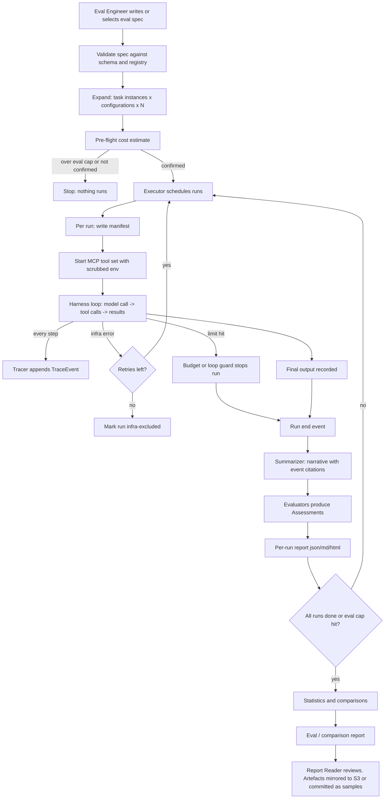

# Software Requirements Specification — Clay Agent-Eval Sandbox

> **For agents — what this file is:** The full requirements for the Clay agent-eval sandbox (ADB agentic eval). It turns the problem statement in [../docs/](../docs/README.md) and the decisions in [design-decisions.md](design-decisions.md) into numbered, testable requirements. The architecture that satisfies them is in [architecture.md](architecture.md). Where this file and `docs/` disagree, `docs/` wins unless a DD entry says otherwise (DD-001). Every requirement traces to a source: an S# requirement or D# decision in `docs/SCOPE.md`, an F#/SC#/J# item in `docs/01`–`04`, or a DD# entry. Terms are defined in the [Glossary](#18-glossary), which overrides the SCOPE glossary where they differ (DD-018).

| Field | Value |
|---|---|
| Product | Clay agent-eval sandbox (working package name `claysandbox`) |
| Beneficiary | Clay (Earth Dataset Foundry), partner ADB |
| Event | AWS Breaking Barriers DC, Nov 3–5 2026 |
| Document version | 1.0 |
| Date | 2026-11-03 |
| Status | Baseline for `plan.md` |
| Decision maker | Team lead |
| Sources | `docs/SCOPE.md`, `docs/01`–`06`, `docs/OPEN-QUESTIONS.md`, `docs/EXTERNAL-DEPENDENCIES.md`, `docs/FUTURE-WORK.md`, `/workshop/wireframe.html`, DD-001 to DD-043 |

Requirement keywords: **MUST** is required for the release it's assigned to. **SHOULD** is expected, but can move to FUTURE-WORK with a recorded reason (D21). **MAY** is optional.

## Contents

1. [Introduction](#1-introduction)
2. [Release goals](#2-release-goals)
3. [Scope](#3-scope)
4. [Personas](#4-personas)
5. [Cross-cutting roles](#5-cross-cutting-roles)
6. [Constraints](#6-constraints)
7. [Dependencies](#7-dependencies)
8. [Complete workflow](#8-complete-workflow)
9. [User journeys](#9-user-journeys)
10. [Use cases](#10-use-cases)
11. [Feature requirements](#11-feature-requirements)
12. [Data requirements](#12-data-requirements)
13. [Interface requirements](#13-interface-requirements)
14. [Cross-cutting (non-functional) requirements](#14-cross-cutting-non-functional-requirements)
15. [Architecturally significant requirements (ADR style)](#15-architecturally-significant-requirements-adr-style)
16. [Traceability matrix](#16-traceability-matrix)
17. [Risks, assumptions and open items](#17-risks-assumptions-and-open-items)
18. [Glossary](#18-glossary)

---

## 1. Introduction

### 1.1 Problem

AI agents in Clay's dataset workflows are a black box. When an agent plans and runs a geospatial dataset build by calling tools, nobody can easily see what it did, and nothing scores it, so nobody can say whether to trust the run (SCOPE, Problem).

### 1.2 Product vision

An open, reproducible **agent-evaluation sandbox**. An Eval Engineer picks synthetic geospatial tasks and one or more agent configurations (model, harness, tool set). The sandbox runs each agent on Amazon Bedrock against real MCP tools, records everything it does as a trace, summarises the trace in plain language, and scores it on two separate dimensions:

- **Workflow** (the main judgment, D9): did it call the right tools, with the right arguments, in the right order, recover from errors, and finish within reasonable steps, time and cost?
- **Output** (D16): how close the final answer is to the task's output reference.

It repeats runs to produce statistics with uncertainty, compares configurations, and keeps full provenance so anyone can audit or replay a result later. Every component that matters (model, harness, tracer, evaluator, tool set, executor) swaps through configuration.

### 1.3 Loop under test

```
Eval spec → Executor → Harness (Bedrock model) ⇄ MCP tool sets
                         │
                         ▼
                   Tracer → Run store → Summarizer → Evaluators → Statistics → Report
```

### 1.4 Intended readers

The five developers (one per workstream, DD-019), the team lead, Clay reviewers, hackathon judges reading the repo, and future contributors.

---

## 2. Release goals

Releases follow Clay's build order: one trace end to end before any scoring, then observe → summarise → score, then swaps, comparisons and statistics, and the UI last (DD-003). Dates are targets. Each release ends with a merge gate where all five workstreams have merged and the exit criteria pass (DD-005).

| Release | Name | Target | Goal | Features delivered | Exit criteria |
|---|---|---|---|---|---|
| **R0** | Walking skeleton | Tue Nov 3, end of day | One live run goes end to end and leaves a trace. Contracts are frozen and every workstream builds against them. | F1 (Strands + Nova Lite + tool set T0), F2 (JSONL tracer, local store), F12 (spec schema + CLI `run`), F13 (one T1 instance), F15 (local executor) | `clay-sandbox run` with the R0 sample spec writes `manifest.json` and `trace.jsonl` holding ≥1 real MCP tool call, model calls with tokens and latency, and a final output. CI is green: unit tests, import boundaries, conformance suites against fakes. |
| **R1** | Scored loop | Wed Nov 4, 12:00 | Observe → summarise → score → report works on real runs, live and replayed. | F3, F4 (deterministic workflow + output evaluators), F5, F7, F13 (T1, T2, T5 on all six AOIs), F2 error capture | J1, J2 and J4 pass. At least one live run and its report are committed under `samples/`. |
| **R2** | MVP complete | Wed Nov 4, 17:30 | Swap, compare and prove statistically. Every parameter reachable through the API. | F4 (LLM process evaluator), F6, F9, F10, F11 (incl. pre-flight estimate), F12 (API), F13 (T3, T4), F14, F15 (Fargate executor and CDK, SHOULD) | J3, J5, J6, J7, J8 and J9 pass. Every item of `docs/05` is ticked, except the license item (C-10) and the UI. FUTURE-WORK.md lists everything cut. |
| **R3** | UI | Thu Nov 5, before 10:00 | A browser UI over the public API, for the demo and the Design criterion. | F8 | From the browser: launch a run, watch status, open its report, open a comparison report. The UI uses only the generated API client. |
| **R4** | Stretch | After R3 | Extend in FUTURE-WORK order. | See §3.3 | Each item has its own acceptance check when picked up. |

**Audience goal (not a persona):** at prelims, judges see a live or replayed run, its report, a comparison with statistics, and a component swap. The four judging criteria (Technological Implementation, Design, Potential Impact, Quality of Idea) are equally weighted (`docs/README.md`).

---

## 3. Scope

### 3.1 In scope (MVP, R0–R3)

- The **ADB agentic eval** only: agents doing ADB-style "find and assemble geospatial data" jobs (SCOPE, Works under).
- Synthetic task templates T1–T5 instantiated over six US counties, with scripted, versioned task references (DD-014, DD-029, DD-030, DD-031).
- Two harnesses (Strands, plain Converse loop), two models under test plus a dev model, two tool sets, two tracers, two or more evaluators, two executors (DD-009, DD-010, DD-011, DD-007, DD-023).
- Trace capture with full error taxonomy, summaries, scoring, reports, replay, re-scoring, comparisons, statistics, budget guard with pre-flight estimate (F1–F12).
- An open `clay-embeddings` MCP server over LGND embeddings (DD-015).
- A run/eval spec and API that expose every parameter, a CLI, a static report renderer, and a TypeScript UI (DD-016).
- Infrastructure as code for the optional AWS parts (DD-024).

### 3.2 Out of scope

From `docs/03`, unchanged: the caption-generation task, training Clay v2, Clay's whole eval backlog, partner or multi-account deployment, continental-scale builds, HyperPod or large Trainium, a production observability or warehouse stack, private or sensitive data, integration with Clay's production systems.

Added by the decisions in this session:

| Item | Why | Source |
|---|---|---|
| Full factorial comparisons across all axes | 32 configurations, unaffordable | DD-026 |
| Authentication on the API | API binds to localhost in the MVP | DD-034 |
| Per-server container isolation and egress allowlists for MCP | Too costly for 2 days | DD-034 |
| Uploading free-text prompts as tasks (wireframe "Synthetic prompts" box) | Tasks come from versioned templates so they always have a task reference | DD-014, DD-028 |
| Running the Clay model to create new embeddings | Pre-computed embeddings only | D4 |

### 3.3 Planned stretch (R4, in order)

Items 1–8 come from `docs/FUTURE-WORK.md`. Items 9 onwards were deferred by decisions in this session and must be added to FUTURE-WORK.md when the build starts.

1. Sensitivity analysis (incl. tool-exposure strategies, DD-008 option B)
2. Multi-agent traces
3. Dynamic MCP tool discovery
4. Richer trace-summary dashboard
5. Agent-written verification code
6. Batch trials on AWS at scale (if the Fargate executor slips from R2)
7. Caption-generation task
8. Third Clay task (once defined)
9. LangGraph as a third harness (DD-009)
10. Model × harness 2×2 interaction (DD-026)
11. Tool set T2 with gis-mcp, "many tools" (DD-033)
12. Non-US AOIs as "data doesn't exist" tests (DD-031)
13. Multi-step template T6 (DD-030)
14. Entry-point plugins (DD-021)
15. Crippled live configuration for evaluator validation (DD-038)
16. CloudWatch dashboard (DD-040)

---

## 4. Personas

Four personas (DD-004). Judges are an audience, covered by the release goals.

| ID | Persona | Who | Goals | Pain today | Main touchpoints | Journeys |
|---|---|---|---|---|---|---|
| **P1** | **Eval Engineer** | Clay or team ML/eval engineer | Run agents on known tasks, compare configurations, get numbers they can defend | Agent runs are opaque. No scores, no way to tell if a difference is real | Eval spec, CLI, API, comparison reports | J1, J3, J5, J6, J7, J9 |
| **P2** | **Task Author** | Team member (WS2) or Clay domain expert | Write task templates and references that are fair, reproducible and auditable | No ADB inputs or rubric exist (D13). Hand-made answer keys don't scale | Template YAML, AOI list, answer-key scripts, planted traces | J4 (bad output), UC-07, UC-08 |
| **P3** | **Report Reader** | Clay/ADB stakeholder deciding whether to trust an agent workflow | Understand what an agent did and how well, without reading code or raw logs | Raw traces are unreadable. Scores without evidence aren't credible | Run report, comparison report, UI | J1 step 5, UC-09 |
| **P4** | **Contributor** | Developer who didn't build it (teammate, Clay engineer, open-source user) | Set it up from the README and reproduce results, with or without AWS | Results that only run on the builder's laptop | README, `samples/`, CI | J8, UC-10 |

---

## 5. Cross-cutting roles

### 5.1 Workstream roles

Five developers, each owning one workstream and building in isolation against frozen contracts (DD-005, DD-044). Each developer's tasks per release are in `dev-docs/plan-<name>.md`.

| Role | Developer | Owns (summary) | Primary features | Main contracts owned |
|---|---|---|---|---|
| **WS1 Agent runtime and cloud execution** | Prithwish | Harnesses, Bedrock model adapter, instrumented wrappers, budget and loop guard, price table, pre-flight estimate, Docker image, CDK stack, Fargate executor | F1, F11, F15 (Docker, CDK, Fargate) | `Harness`, `ModelAdapter`, `BudgetGuard`, `PriceTable`, `CostEstimate` |
| **WS2 Tools and tasks** | Vishal | MCP tool-set launcher, tool sets, `clay-embeddings` server, task templates, AOIs, answer keys | F1 (tools), F13, F14 | `ToolSet`, `TaskTemplate`, `TaskReference` |
| **WS3 Trace and store** | Shivaani | Trace schema, tracers, tracer comparison, run store, replay loader, summarizer, sample and planted traces | F2, F3, F7 (loading), F9 (tracer comparison) | `TraceEvent`, `Tracer`, `RunStore`, `Summarizer` |
| **WS4 Evaluation and statistics** | Barath | Evaluators, statistics, agent and evaluator comparisons, evaluator validation, eval report content, live-journey script and live release-gate evals | F4, F9 (analysis), F10 | `Evaluator`, `Assessment`, `StatsResult` |
| **WS5 Platform and presentation** | 5th member | Scaffold, CI, eval spec, manifest, registry, service layer, local executor, CLI, API, report renderers, README, UI shell | F5, F6, F7 (service), F8, F9 (orchestration), F12, F15 (local executor) | `EvalSpec`, `RunManifest`, `Executor`, `Report`, OpenAPI |

The R3 UI screens are shared across all five developers (DD-044).

### 5.2 Duties every role shares

| Duty | Requirement |
|---|---|
| Contracts | All five write `contracts/` together in the first hour of R0. After R0, a contract change needs a new DD entry and a `schema_version` bump (DD-005, DD-011). |
| Conformance | Each implementation of an interface passes that interface's conformance suite before merge (DD-035). |
| Fakes | Each owner ships a fake of their interface in `contracts/fakes/` so the others can test alone (DD-005). |
| Error tagging | Any component that can fail records errors with a `source` from the taxonomy in §12.4 (D12, DD-012). |
| Provenance | Any component that affects a result reports its name and version for the run manifest (SC7). |
| FUTURE-WORK | Whoever cuts or defers something adds the row to `docs/FUTURE-WORK.md` the same day (D21). |
| README | Each owner writes the README section for their part (how to run, swap, configure). |
| Merge gate | The team lead runs the release exit criteria (§2) after all five merge, and decides go or no-go. |

---

## 6. Constraints

| ID | Constraint | Source |
|---|---|---|
| C-01 | The agent's model runs on **Amazon Bedrock**, behind an abstraction | SCOPE constraints, D7 |
| C-02 | Backend in **Python 3.12+**, managed with uv and a committed lockfile | SCOPE, DD-036 |
| C-03 | AWS sandbox spend capped at **$500**, shared by all runs and infrastructure | `docs/README.md` |
| C-04 | Region **us-west-2** (NAIP, LGND embeddings and the sandbox) | DD-010 |
| C-05 | **Public or synthetic data only.** No private or sensitive data | `docs/03`, S13 |
| C-06 | Public GitHub repo up before judging (**Thu Nov 5, 10:00**). Build hours not binding | `docs/README.md`, D18 |
| C-07 | **Single sandbox account.** No partner or cross-account setup | `docs/03` |
| C-08 | **Modest compute only.** No HyperPod or large Trainium | SCOPE (interpretation) |
| C-09 | Sandbox **wiped after the event**. Everything that matters lives in the repo | `docs/06` |
| C-10 | **License is MIT**, a known deviation from Clay's Apache-2.0 requirement. Ask Clay at kickoff and switch if they insist | DD-017, DD-037 |
| C-11 | UI in **TypeScript or JavaScript**, built after the backend | S8, D11, DD-036 |
| C-12 | **No ADB inputs.** All tasks are synthetic and generated by the team | D13, D19 |
| C-13 | Clay embeddings are **pre-computed** LGND embeddings. We don't run the model | D4 |
| C-14 | Data licenses apply on top of the code license: LGND embeddings CC BY 4.0, OSM ODbL, Global Renewables Watch MIT, NAIP public domain. Attribution in README and in reports that use the data | EXTERNAL-DEPENDENCIES, DD-015 |
| C-15 | Five developers, isolated workstreams, merge at each release gate | DD-005 |
| C-16 | Source PDFs stay out of the repo. All md files are pushed | D15, D22 |

---

## 7. Dependencies

### 7.1 External

| ID | Dependency | Needed for | Release | Status (2026-11-03) | Owner | Fallback |
|---|---|---|---|---|---|---|
| X-01 | Sandbox account with Bedrock model access in us-west-2 (Nova Lite, Nova Pro, Claude Sonnet-class, an out-of-family judge) | All live runs | R0 | To request on Day 1 | Team lead | Replay of committed runs |
| X-02 | RODA MCP server (`awslabs.roda-mcp-server`) | Tool set T0/T1 | R0 | Links OK, install not tested | WS2 | — (known-good tool) |
| X-03 | stac-mcp and a public STAC API with a NAIP collection | T1 | R1 | Not tested | WS2 | Query NAIP through RODA only |
| X-04 | openstreetmap-mcp-server | Geocoding AOIs | R1 | Not tested | WS2 | AOIs given as bbox in the prompt |
| X-05 | LGND embeddings on Source Cooperative (`s3://us-west-2.opendata.source.coop/clay/lgnd-embeddings/`) | F14, T4 | R2 | Verified: public GeoParquet, Sentinel-2, v1.5, 256 or 1024 dims, CC BY 4.0 | WS2 | Drop T4 to FUTURE-WORK |
| X-06 | LGND Geo MCP (commercial) | Optional tool set | R2 (MAY) | Whitelist unconfirmed | Team lead → Clay | Our own server (X-05) |
| X-07 | NAIP on S3 (Requester-Pays, us-west-2) | T1 answer keys and agent reads | R1 | Link OK | WS2 | Pre-staged small sample |
| X-08 | Global Renewables Watch v1.0 | T3 answer keys | R2 | Link OK | WS2 | USPVDB if reachable |
| X-09 | AWS Registry of Open Data metadata | T2 answer keys | R1 | OK | WS2 | Hand-curated list |
| X-10 | AWS Price List API | Price table refresh | R2 | Standard API | WS1 | Hand-entered table |
| X-11 | Strands Agents SDK, MCP Python SDK, boto3, FastAPI, Pydantic, DuckDB, numpy/scipy, OpenTelemetry SDK, AWS CDK | Build | R0 | Public packages | All | — |
| X-12 | GitHub repo and Actions | CI, publishing | R0 | Repo exists (D20) | WS5 | — |
| X-13 | Clay answers at kickoff: shortlist, LGND whitelist, license, third task, ADB rubric, task review | Several | R1 | Open (`docs/06`) | Team lead | Decisions as recorded (DD-033, DD-037) |

### 7.2 Internal (feature → feature)

| Feature | Depends on |
|---|---|
| F1 Harness | F13 (task instance), F2 (tracer contract), F11 (guard contract) |
| F2 Trace capture | `TraceEvent` contract only |
| F3 Summary | F2 |
| F4 Scoring | F2, F13 (task reference) |
| F5 Report | F3, F4, manifest from F12 |
| F6 Hot-swap | F12 registry, two implementations each from F1/F2/F4 |
| F7 Replay | F2, F3, F4, F5 |
| F8 UI | F12 API, F5 report JSON |
| F9 Comparison | F4, F10, F12 |
| F10 Statistics | F4 |
| F11 Budget guard | F2 (cost events), pricing |
| F12 Spec/API | Every registry entry |
| F13 Task library | F14 for T4 |
| F15 Executors | F12 service layer |

---

## 8. Complete workflow

### 8.1 End-to-end eval lifecycle



### 8.2 Steps in words

| # | Step | Actor / component | Output |
|---|---|---|---|
| 1 | Write or pick an eval spec (YAML/JSON or API body) | P1 | Eval spec |
| 2 | Validate the spec: schema, registered names, task instances exist | Service layer | Validated spec or field errors |
| 3 | Expand into a run plan: task instances × configurations × N | Service layer | Run plan |
| 4 | Pre-flight estimate of agent and evaluation cost; check against the eval-level cap | Estimator | Estimate (with "guess" flag if no history) |
| 5 | User confirms (CLI prompt or `confirm: true`) | P1 | Eval started |
| 6 | Executor runs each planned run (local process pool or Fargate task) | Executor | Run folders |
| 7 | Write the run manifest before the first model call | Service layer | `manifest.json` |
| 8 | Launch the MCP servers of the configured tool set with a scrubbed environment | Tool-set launcher | Live MCP sessions + tool schemas |
| 9 | Run the agent loop. Every model call, tool call, result, error and guard stop becomes a `TraceEvent` | Harness + tracer | `trace.jsonl` (and OTel spans if configured) |
| 10 | End the run: final output, or a guard stop, or an error | Harness | `run_end` event with status |
| 11 | Infra errors: retry the whole run up to the configured limit, then mark it excluded | Executor | Attempts recorded in the manifest |
| 12 | Summarise the trace. Claims without a valid event citation are dropped | Summarizer | `summary.json` |
| 13 | Score with every configured evaluator. Each produces an Assessment | Evaluators | `assessments/<evaluator>@<ver>.json` |
| 14 | Render the per-run report | Report renderer | `report.json`, `report.md`, `report.html` |
| 15 | When all runs finish (or the eval cap stops new launches): compute statistics and comparisons | Statistics | `eval_report.*` |
| 16 | Optionally mirror the run and eval folders to S3, and commit chosen ones under `samples/` | P1 / store | Durable artefacts |
| 17 | Later: replay or re-score any stored run with any evaluator, no live model | P1 | New Assessments, new reports |

### 8.3 Run lifecycle states

| State | Meaning | Next states |
|---|---|---|
| `planned` | In the run plan, not started | `running`, `skipped_eval_cap` |
| `running` | Manifest written, harness active | `completed`, `budget_stopped`, `agent_failed`, `infra_retry` |
| `infra_retry` | Infra error, a new attempt is scheduled | `running`, `infra_excluded` |
| `completed` | Final output produced | terminal |
| `budget_stopped` | A budget or loop guard limit was hit | terminal (counts as failure) |
| `agent_failed` | Ended without output because of agent or tool errors | terminal (counts as failure) |
| `infra_excluded` | Retries used up on infra errors | terminal (excluded from statistics) |
| `skipped_eval_cap` | Not launched because the eval-level $ cap was reached | terminal (reported, not scored) |

Scoring (summary, assessments, report) runs for every terminal state except `skipped_eval_cap`.

---

## 9. User journeys

The acceptance tests are J1–J9 in [`docs/04`](../docs/04-user-journeys-tests.md), and they stay authoritative. This section adds the persona view and the changes the decisions made.

### 9.1 Journey-to-persona map

| Journey | Persona | Proves | Release | Notes from decisions |
|---|---|---|---|---|
| J1 Evaluate one live run | P1, P3 | SC1–SC4, SC7 | R1 | Manifest fields per §12.2. Report formats per DD-039 |
| J2 Replay a recorded trace | P1, P4 | SC6 | R1 | Replay creates an Assessment, never a Run (DD-018) |
| J3 Hot-swap every component | P1 | SC5 | R2 | Swaps by registry name (DD-021). Tracer swap keeps the `TraceEvent` schema (DD-011) |
| J4 Errors caught and logged | P1, P2 | SC2 | R1 | Taxonomy and recovery credit per DD-012 |
| J5 Compare configurations | P1 | SC8 | R2 | One-change variants, plus evaluator and tracer comparisons (DD-026) |
| J6 Statistical verification | P1, P3 | SC9 | R2 | Paired by task instance, N=3 (DD-025). Planted traces (DD-038) |
| J7 Budget guard | P1 | SC10 | R2 | Plus eval cap and pre-flight estimate (DD-013) |
| J8 Reproducible on another machine | P4 | SC12 | R2 | Replay in CI with no AWS (DD-035) |
| J9 Every parameter exposed | P1 | SC11 | R2 | `GET /schema/eval-spec`, `GET /registry` |

### 9.2 Persona journey narratives

**P1 Eval Engineer: "Is Sonnet better than Nova Pro at this?"**

1. Opens `specs/compare-models.yaml`, which has a baseline (Nova Pro + Strands + T1) and one variant (Sonnet-class model).
2. Runs `clay-sandbox estimate specs/compare-models.yaml`. Sees about 180 runs and an estimated $X, labelled from history.
3. Runs `clay-sandbox eval specs/compare-models.yaml` and confirms.
4. Watches status with `clay-sandbox status <eval_id>` (in R3, in the UI).
5. Opens `eval_report.md`: success rate with Wilson CI per configuration, workflow and output metrics with bootstrap CIs, the paired difference with p-value and effect size, and a plain sentence saying whether the difference is meaningful.
6. Clicks through to one run that lost points and reads its summary and evidence.

**P2 Task Author: "Add a county and make sure the key is right."**

1. Adds a county to `tasks/aois.yaml` (name, FIPS code, bbox, solar yes/no).
2. Runs `clay-sandbox tasks build-references --template T1 --aoi <id>`. Scripts generate the answer key and stamp a new reference version.
3. Spot-checks one instance and records `checked_by` and `checked_at` (DD-029).
4. Runs `clay-sandbox validate-evaluator` against planted traces to confirm the new reference still separates good from bad.

**P3 Report Reader: "Can I trust this agent workflow?"**

1. Opens `report.html` (or the Report screen in R3).
2. Reads the header (task, model, harness, tool set, evaluator, reference version), then two headline numbers (workflow, output) with sub-score bars.
3. Reads the summary. Each sentence links to the trace events it's based on.
4. Opens the timeline. Errors are red, each with its source (agent, tool, budget, infra) and whether the agent recovered.
5. Opens the provenance section: exact prompt, system prompt, tool schemas, versions, cost and latency per step.

**P4 Contributor: "Does this actually work without the authors?"**

1. Clones the repo and runs `uv sync`, then `clay-sandbox replay samples/runs/<id>`, with no AWS credentials.
2. Gets a report with identical deterministic scores to the committed one.
3. Runs `uv run pytest` and sees the same tests CI runs.
4. Optionally adds AWS credentials and runs the R0 sample spec live.

---

## 10. Use cases

### UC-01 Run a single live evaluation

| | |
|---|---|
| Actor | P1 Eval Engineer |
| Preconditions | AWS credentials with Bedrock access. Task instance and tool set exist. MCP servers installable |
| Trigger | `clay-sandbox run <spec>` or `POST /evals` with one configuration, one task instance, N=1 |
| Main flow | 1. Spec validated. 2. Pre-flight estimate shown. 3. Manifest written. 4. Tool set launched. 5. Harness runs to final output, tracing every step. 6. Summary, assessments and report produced. 7. Run ID and report path returned |
| Alternatives | 2a. Estimate over the eval cap: refuse to start. 5a. Guard limit hit: run ends `budget_stopped` and is still scored. 5b. Infra error: retried per spec, then `infra_excluded`. 5c. MCP server fails to start: tool-side error, run ends `agent_failed` with the error in the trace |
| Postconditions | Run folder holds manifest, trace, summary, assessments and reports |
| Requirements | FR-1.*, FR-2.*, FR-3.*, FR-4.*, FR-5.* |

### UC-02 Run a comparison eval

| | |
|---|---|
| Actor | P1 |
| Preconditions | As UC-01. Spec has a baseline and ≥1 variant |
| Trigger | `clay-sandbox eval <spec>` or `POST /evals` |
| Main flow | 1. Spec expanded: every configuration runs on the same task instances, N times each. 2. Estimate and confirm. 3. Runs executed (UC-01 steps 3–6 per run). 4. Statistics computed per configuration. 5. Paired comparison of each variant against the baseline. 6. Eval report produced |
| Alternatives | 3a. Eval cap reached: remaining runs `skipped_eval_cap`. The report says which and how many, and compares only task instances complete in every configuration |
| Postconditions | Eval folder with `eval_report.*` and links to every run |
| Requirements | FR-9.*, FR-10.*, FR-11.* |

### UC-03 Estimate an eval's cost before launch

| | |
|---|---|
| Actor | P1 |
| Trigger | `clay-sandbox estimate <spec>` or `POST /evals/estimate` |
| Main flow | 1. Run plan computed. 2. Median tokens per (template, model, harness) taken from stored runs. 3. Price table applied for agent, summary and LLM evaluator calls. 4. Requester-Pays reads estimated. 5. Total, per-configuration and per-run figures returned with the price table version |
| Alternatives | 2a. No history: a default token count is used and the estimate is flagged `basis: default_guess` |
| Requirements | FR-11.6 to FR-11.9 |

### UC-04 Replay a stored run

| | |
|---|---|
| Actor | P1, P4 |
| Preconditions | A run folder exists (local, S3 or `samples/`). No model access needed |
| Trigger | `clay-sandbox replay <run_path>` or `POST /runs/{id}/replay` |
| Main flow | 1. Trace loaded and schema version checked. 2. Summary reused or regenerated. 3. Configured evaluators produce new Assessments. 4. Report re-rendered. 5. Deterministic scores compared with the stored ones |
| Alternatives | 2a. Offline mode and summary needs an LLM: the stored summary is reused and the report says so. 3a. LLM evaluator configured while offline: it's skipped and the report says so |
| Postconditions | New Assessments appended. The trace is unchanged |
| Requirements | FR-7.* |

### UC-05 Re-score runs with a different evaluator

| | |
|---|---|
| Actor | P1 |
| Trigger | `clay-sandbox rescore --evaluator <name@ver> <run_ids or eval_id>` or `POST /assessments/batch` |
| Main flow | 1. Runs selected. 2. New evaluator applied to each stored trace. 3. New Assessments stored next to old ones. 4. Reports regenerated with the evaluator version shown |
| Requirements | FR-6.4, FR-7.3 |

### UC-06 Compare measurement instruments (evaluators, tracers)

| | |
|---|---|
| Actor | P1 |
| Main flow (evaluators) | 1. Pick a set of stored runs plus the planted traces. 2. Score them with each evaluator. 3. Report agreement between evaluators, each evaluator's good-vs-bad separation, and LLM evaluator self-agreement over k repeats |
| Main flow (tracers) | 1. Run a configuration with the tee tracer (both tracers record the same run). 2. Report capture overhead per event, events lost, and round-trip fidelity (re-read events equal written events) |
| Requirements | FR-9.5, FR-9.6 |

### UC-07 Author a task template and build its references

| | |
|---|---|
| Actor | P2 Task Author |
| Main flow | 1. Write template YAML: prompt template, parameters, workflow spec (DD-028), output reference builder, metric, weights. 2. Add or reuse AOIs. 3. Run the reference builder for each instance. 4. Spot-check one instance and record it. 5. Run planted-trace validation |
| Alternatives | 3a. Source data unreachable: build fails with a clear error and no reference version is created |
| Postconditions | New versioned task references committed |
| Requirements | FR-13.* |

### UC-08 Validate the evaluator with planted traces

| | |
|---|---|
| Actor | P2, P1 |
| Trigger | `clay-sandbox validate-evaluator [--evaluator ...]` (also runs in CI) |
| Main flow | 1. Load planted good and bad traces for each template. 2. Score them. 3. Report detection rate per flaw type and the good-vs-bad score margin compared with the CI width from the latest live eval |
| Requirements | FR-10.6, FR-10.7 |

### UC-09 Read a report and decide on trust

| | |
|---|---|
| Actor | P3 Report Reader |
| Main flow | 1. Open a run or eval report. 2. Read headline scores and sub-scores. 3. Read the summary and follow citations to trace events. 4. Check provenance. 5. For a comparison, read the plain-language verdict and uncertainty |
| Requirements | FR-3.*, FR-5.*, FR-9.4, FR-10.5 |

### UC-10 Reproduce on a fresh machine

| | |
|---|---|
| Actor | P4 Contributor |
| Main flow | 1. Clone. 2. Install uv and run `uv sync`. 3. Replay a committed sample run with no AWS credentials. 4. Run the test suite. 5. Optionally run live with their own AWS account |
| Requirements | FR-12.6 to FR-12.8, NFR-REP-* |

### UC-11 Run an eval on ECS Fargate

| | |
|---|---|
| Actor | P1 |
| Preconditions | CDK stack deployed, image pushed to ECR |
| Trigger | Spec with `executor: {name: fargate}` |
| Main flow | 1. Service layer starts one Fargate task per run (or per batch). 2. Each task runs the same image and writes the run folder to S3. 3. Service layer polls S3 for status. 4. Statistics and reports run where the service runs |
| Requirements | FR-15.* |

### UC-12 Discover every option through the API

| | |
|---|---|
| Actor | P1, future UI |
| Trigger | `GET /schema/eval-spec`, `GET /registry` |
| Main flow | 1. Get the JSON Schema of the eval spec. 2. Get every registered component with its parameter schema. 3. Build a valid spec from those alone. 4. Launch it through `POST /evals` |
| Requirements | FR-12.1 to FR-12.5 |

---

## 11. Feature requirements

Each feature lists its description, user stories, functional requirements, use cases and acceptance journeys. F1–F12 keep their numbers from `docs/01`. F13–F15 were added by this session's decisions.

### F1 - LLM harness over MCP tools

**Description.** An agent on Amazon Bedrock performs a synthetic task instance by calling geospatial tools over MCP. Two harnesses implement one interface: Strands Agents (D7) and a plain Bedrock Converse tool loop (DD-009). Models under test are Nova Pro and a Claude Sonnet-class model, with Nova Lite for development (DD-010). Tool sets are T0 (RODA) and T1 (RODA + stac-mcp + openstreetmap-mcp-server + clay-embeddings) (DD-033).

| Release | Priority | Owner | Sources |
|---|---|---|---|
| R0 (Strands, T0), R1 (T1 servers), R2 (Converse loop, Sonnet) | Must | WS1, WS2 | F1, D4, D7, D13, DD-009, DD-010, DD-033 |

**User stories**

- US-1.1 As an Eval Engineer, I want to run an agent on a task instance with a chosen model, harness and tool set, so that I can observe how it works.
- US-1.2 As an Eval Engineer, I want both harnesses to see the same tools with the same schemas, so that a harness comparison is fair.
- US-1.3 As a Task Author, I want the prompt to come from the template and AOI, so that every run of an instance gets identical input.

**Functional requirements**

| ID | Requirement | Priority | Verified by |
|---|---|---|---|
| FR-1.1 | The system MUST run an agent loop on Bedrock that takes a task instance prompt and system prompt and returns a final output | Must | J1.2 |
| FR-1.2 | The system MUST connect the agent to every MCP server in the configured tool set and expose their tools with the exact schemas the servers publish | Must | J1.2 |
| FR-1.3 | Both harnesses MUST implement the same `Harness` interface and receive the same model adapter, tool set, tracer and guard | Must | Conformance suite |
| FR-1.4 | The Bedrock model adapter MUST record per call: model ID, inference parameters, input and output tokens, latency and stop reason | Must | J1.2 |
| FR-1.5 | Model ID and inference parameters MUST come only from the spec, never from code | Must | J3.1 |
| FR-1.6 | The harness MUST stop when the model returns a final answer, a guard stops the run, or an unrecoverable error occurs, and MUST emit a `run_end` event with the terminal state | Must | J1.2, J7 |
| FR-1.7 | A tool call to a tool name that doesn't exist MUST be returned to the model as an error result (not crash the run) and be traced as an agent error | Must | J4.2 |
| FR-1.8 | Tool calls whose arguments fail the tool's JSON Schema MUST be traced as agent errors before or after the call (whichever the harness can detect) | Must | J4.2 |
| FR-1.9 | MCP servers MUST start with a scrubbed environment and only receive AWS credentials if their tool-set entry says so | Must | DD-034 review |
| FR-1.10 | MCP server versions MUST be pinned in the tool-set definition | Must | DD-034 review |
| FR-1.11 | The harness MUST be deterministic in everything except the model: same tool order, same prompt assembly, seed recorded | Should | Manifest check |

**Use cases:** UC-01, UC-02. **Acceptance:** J1, J3, J4.

### F2 - Trace capture

**Description.** Every step of a run is recorded as a `TraceEvent` in our own versioned schema (DD-011). The JSONL tracer is the default. The OpenTelemetry tracer exports to CloudWatch/X-Ray (D8). A tee tracer writes to both (DD-026). Every error is captured and tagged by source (D12, DD-012).

| Release | Priority | Owner | Sources |
|---|---|---|---|
| R0 (JSONL), R1 (all error types), R2 (OTel, tee) | Must | WS3 (schema, tracers), WS1 (emitting events) | F2, S3, S5, D5, D8, D12, DD-011, DD-012 |

**User stories**

- US-2.1 As an Eval Engineer, I want every model call, tool call, result and error in order with timing and cost, so that I can see exactly what happened.
- US-2.2 As a Report Reader, I want every error tagged with where it came from, so that I know whether to blame the agent.
- US-2.3 As an Eval Engineer, I want to switch the tracer backend without the trace content changing, so that results stay comparable.

**Functional requirements**

| ID | Requirement | Priority | Verified by |
|---|---|---|---|
| FR-2.1 | The system MUST write one `TraceEvent` per run start, model call, tool call (with its result or error), guard stop, error, final output and run end, with a sequence number and event ID | Must | J1.2 |
| FR-2.2 | Each tool-call event MUST hold server, tool name, arguments, result or error, start and end time, latency and status | Must | J1.2 |
| FR-2.3 | Each model-call event MUST hold tokens, latency, stop reason and computed cost with the price table version | Must | J1.5 |
| FR-2.4 | Every error MUST carry `source` (agent, tool, budget, infra), `kind` from the taxonomy in §12.4, message, and whether it was retryable | Must | J4 |
| FR-2.5 | Large tool results MUST be stored in full in a side file and referenced by hash from the event, with a truncated preview inline | Must | Unit test |
| FR-2.6 | The trace MUST be written incrementally, so a crash still leaves every event up to the crash | Must | Fault test |
| FR-2.7 | The JSONL and OTel tracers MUST serialise the same `TraceEvent`s. Reading them back MUST give equal events | Must | J3.2, tracer conformance |
| FR-2.8 | The tee tracer MUST record the same run through two tracers and record each tracer's capture overhead | Should | UC-06 |
| FR-2.9 | Trace schema version MUST be stored in every event. Readers MUST accept all earlier versions | Must | Conformance |
| FR-2.10 | Secrets (AWS keys, tokens) MUST NOT appear in traces. The tracer MUST redact known secret patterns | Must | Unit test |

**Use cases:** UC-01, UC-04, UC-06. **Acceptance:** J1, J3, J4.

### F3 - Trace summarisation

**Description.** An LLM (Nova Lite, DD-027) writes a plain-language account of the run. Each claim cites trace event IDs. Code checks every citation and drops claims that cite nothing valid (DD-007). A deterministic fallback summary is generated from the trace when the LLM is unavailable.

| Release | Priority | Owner | Sources |
|---|---|---|---|
| R1 | Must | WS3 | F3, S4, DD-007, DD-027 |

**User stories**

- US-3.1 As a Report Reader, I want a short readable account of what the agent did and where it struggled, so that I don't have to read the raw trace.
- US-3.2 As a Report Reader, I want each sentence linked to the events behind it, so that I can check it.

**Functional requirements**

| ID | Requirement | Priority | Verified by |
|---|---|---|---|
| FR-3.1 | The summary MUST list the steps in order and point out every failure, retry and dead end in the trace | Must | J1.3 |
| FR-3.2 | Every claim MUST cite ≥1 event ID that exists in the trace. Claims without valid citations MUST be dropped and the count of dropped claims recorded | Must | J1.3, unit test |
| FR-3.3 | Every error event in the trace MUST be mentioned in the summary. If the LLM summary misses one, a deterministic line for it MUST be added | Must | J4.1 |
| FR-3.4 | When no LLM is available, a deterministic summary MUST be generated from the trace | Must | J2 offline |
| FR-3.5 | The summary model, prompt version and token cost MUST be recorded, as evaluation cost (separate from agent cost) | Must | Report check |

**Use cases:** UC-01, UC-04, UC-09. **Acceptance:** J1, J4.

### F4 - Scoring (workflow and output)

**Description.** Evaluators turn a trace plus a task reference into an Assessment. The deterministic workflow evaluator checks the trace against the expected-workflow spec (DD-028) and reports sub-scores and a weighted composite (DD-041). The deterministic output evaluator computes the template's output metric against the output reference (OQ12). The optional LLM process evaluator rates planning and recovery against a written rubric, scored k=3 times, and is always reported separately (DD-007, DD-027).

| Release | Priority | Owner | Sources |
|---|---|---|---|
| R1 (deterministic), R2 (LLM process evaluator) | Must | WS4 | F4, SC3, D9, D16, S12, DD-007, DD-012, DD-028, DD-041 |

**User stories**

- US-4.1 As an Eval Engineer, I want each run scored on workflow and output separately, so that a lucky answer doesn't hide a bad process.
- US-4.2 As a Report Reader, I want every score to show its evidence, so that I can trust it.
- US-4.3 As an Eval Engineer, I want an agent that recovers from a tool failure to lose fewer points than one that doesn't.

**Functional requirements**

| ID | Requirement | Priority | Verified by |
|---|---|---|---|
| FR-4.1 | The workflow evaluator MUST compute these sub-scores in [0,1]: tool-call validity, argument constraints, required-tool coverage, ordering rules, forbidden-tool use, error recovery, step efficiency, done condition | Must | J1.4 |
| FR-4.2 | Each sub-score MUST list the trace event IDs it is based on | Must | J1.4 |
| FR-4.3 | The composite workflow score MUST be the weighted mean of sub-scores with weights from the task reference (default equal) | Must | Unit test |
| FR-4.4 | Agent and tool errors MUST lower the score. A tool error the agent recovered from MUST cost less than an unrecovered one. Infra errors MUST NOT affect the score (DD-012) | Must | J4.1, planted traces |
| FR-4.5 | Latency and cost MUST be reported per run and per step as raw metrics next to the scores | Must | J1.5 |
| FR-4.6 | The output evaluator MUST compute the template's metric (§12.3) against the instance's output reference, deterministically | Must | J4.3 |
| FR-4.7 | Output metrics MUST NEVER be blended into workflow scores | Must | Report check |
| FR-4.8 | Each Assessment MUST record evaluator name and version, task-reference version and creation time | Must | J3.4 |
| FR-4.9 | The LLM process evaluator MUST use a model family not under test, temperature 0, score k times (default 3), and report the mean and spread | Should (R2) | J2.3, UC-06 |
| FR-4.10 | Workflow rules MUST refer to tools by capability, mapped to concrete tools by the tool-set definition, so a rule still applies when tool sets change | Must | Unit test with T0 and T1 |
| FR-4.11 | Run success MUST be computed as: done condition met and no budget or loop guard stop. Infra-excluded runs are neither success nor failure (DD-042) | Must | Unit test |

**Use cases:** UC-01, UC-04, UC-05. **Acceptance:** J1, J4.

### F5 - Evaluation report and provenance

**Description.** Every run gets a report: canonical `report.json`, rendered to `report.md` and self-contained `report.html` (DD-039). The run manifest holds the full context the agent was given (OQ6, SC7).

| Release | Priority | Owner | Sources |
|---|---|---|---|
| R1 | Must | WS5 (renderer, manifest), WS4 (content) | F5, S6, SC4, SC7, D9, DD-039 |

**User stories**

- US-5.1 As a Report Reader, I want one page with the summary, scores, output metric, cost, latency and full context, so that I can judge the run.
- US-5.2 As an Eval Engineer, I want the exact prompt, tools, model and versions saved with every run, so that I can explain or rerun it.

**Functional requirements**

| ID | Requirement | Priority | Verified by |
|---|---|---|---|
| FR-5.1 | Every run MUST have a manifest written before the first model call, holding the fields in §12.2 | Must | J1.1 |
| FR-5.2 | Every run that reaches a terminal state (except `skipped_eval_cap`) MUST get a report | Must | J1.5 |
| FR-5.3 | The report MUST contain: header (task instance, configuration, versions), headline workflow composite and output metric, sub-scores with evidence, summary with citations, timeline of events with errors highlighted, per-run and per-step latency and cost (agent and evaluation separately), full manifest, path to raw trace | Must | J1.5 |
| FR-5.4 | `report.md` MUST render readably on GitHub. `report.html` MUST work offline with no external assets | Must | Manual check |
| FR-5.5 | A report with several Assessments MUST show each evaluator separately with its version | Must | J3.4 |
| FR-5.6 | Reports using embedding or OSM results MUST include the data attribution (C-14) | Must | Review |

**Use cases:** UC-01, UC-09. **Acceptance:** J1.

### F6 - Hot-swappable components

**Description.** Model, harness, tracer, trace evaluator, tool set and executor are each chosen by name in the spec and resolved by a registry (DD-021).

| Release | Priority | Owner | Sources |
|---|---|---|---|
| R2 | Must | WS5 (registry), every WS (registrations) | F6, S1, S2, D2, SC5, DD-021 |

**User stories**

- US-6.1 As an Eval Engineer, I want to change one value in the spec to swap a component, so that comparisons need no code edits.
- US-6.2 As an Eval Engineer, I want to re-score old runs with a new evaluator without re-running the agent.

**Functional requirements**

| ID | Requirement | Priority | Verified by |
|---|---|---|---|
| FR-6.1 | Model, harness, tracer, evaluator, tool set and executor MUST each be selected by registry name plus parameters in the spec | Must | J3 |
| FR-6.2 | An unknown name MUST fail spec validation with the list of valid names | Must | Unit test |
| FR-6.3 | The registry MUST publish each component's name, version and parameter schema | Must | J9.1 |
| FR-6.4 | Swapping the evaluator MUST re-score stored traces without re-running the agent | Must | J3.4 |
| FR-6.5 | Every swap MUST be visible in the manifest or Assessment | Must | J3 |

**Use cases:** UC-02, UC-05, UC-12. **Acceptance:** J3.

### F7 - Replay and re-score

**Description.** Stored runs replay through summarise → score → report with no live agent and, if needed, no AWS access. Replay and re-scoring create Assessments, never Runs (DD-018).

| Release | Priority | Owner | Sources |
|---|---|---|---|
| R1 | Must | WS3 (loader), WS5 (service, CLI) | F7, SC6, D2, OQ5, DD-018 |

**User stories**

- US-7.1 As an Eval Engineer, I want a report from a recorded trace when the live agent fails during the demo.
- US-7.2 As a Contributor, I want to replay committed samples with no AWS credentials.

**Functional requirements**

| ID | Requirement | Priority | Verified by |
|---|---|---|---|
| FR-7.1 | Replay MUST read a run folder from local disk, S3 or `samples/` and produce a report | Must | J2.2 |
| FR-7.2 | In offline mode, replay MUST make no Bedrock call. This MUST be checkable from logs | Must | J2.1 |
| FR-7.3 | Replay MUST store new Assessments next to existing ones and never modify the trace or manifest | Must | Unit test |
| FR-7.4 | Deterministic evaluator scores from replay MUST equal the live scores exactly. LLM evaluator variance MUST be reported | Must | J2.3 |
| FR-7.5 | Replay MUST accept traces of every earlier schema version | Must | Conformance |

**Use cases:** UC-04, UC-05, UC-10. **Acceptance:** J2, J3.4, J8.

### F8 - UI (TypeScript)

**Description.** A React + Vite + TypeScript app (DD-036) with four screens, based on the wireframe: New Run, Runs, Report, Comparison. It uses only the generated API client (DD-016).

| Release | Priority | Owner | Sources |
|---|---|---|---|
| R3 | Should | WS5 (shell, client, New Run), all (one screen each, DD-044) | F8, S8, D11, DD-016, DD-036, wireframe |

**User stories**

- US-8.1 As an Eval Engineer, I want to launch a run or eval from the browser using only registered options.
- US-8.2 As a Report Reader, I want to browse runs and open reports and comparisons in the browser.

**Functional requirements**

| ID | Requirement | Priority | Verified by |
|---|---|---|---|
| FR-8.1 | New Run screen MUST build its form from `GET /schema/eval-spec` and `GET /registry` (task template, AOI, model, harness, tool set, tracer, evaluators, N, budget, executor), show the pre-flight estimate, then launch | Should | Manual |
| FR-8.2 | Runs screen MUST list runs with task, configuration, state, workflow composite and output metric, with filters | Should | Manual |
| FR-8.3 | Report screen MUST show the same content as `report.json` (FR-5.3) | Should | Manual |
| FR-8.4 | Comparison screen MUST show per-configuration statistics with CIs and the paired verdicts | Should | Manual |
| FR-8.5 | Status MUST update through the API's server-sent events stream | Should | Manual |
| FR-8.6 | The UI MUST use the label "task reference", not "rubric" (DD-018) | Should | Review |
| FR-8.7 | The UI MUST NOT call anything except the generated API client | Must (if F8 ships) | Code review, CI |

**Use cases:** UC-01, UC-02, UC-09, UC-12. **Acceptance:** R3 exit criteria.

### F9 - Comparison eval

**Description.** Configurations differing in exactly one agent axis (model, harness, tool set) run on the same task instances and are compared to a baseline (DD-026). Evaluators are compared by re-scoring the same runs. Tracers are compared by recording the same runs with a tee tracer.

| Release | Priority | Owner | Sources |
|---|---|---|---|
| R2 | Must | WS4 (agent and evaluator analysis), WS3 (tracer comparison), WS5 (orchestration) | F9, S10, D3, SC8, DD-008, DD-026, DD-044 |

**User stories**

- US-9.1 As an Eval Engineer, I want a side-by-side comparison of a baseline and its variants, with which is better and by how much.
- US-9.2 As an Eval Engineer, I want to compare two evaluators on the same runs, to know which one to trust.
- US-9.3 As an Eval Engineer, I want to know what each tracer costs in overhead and whether it loses events.

**Functional requirements**

| ID | Requirement | Priority | Verified by |
|---|---|---|---|
| FR-9.1 | An eval spec MUST support one baseline and one or more variants defined as overrides of the baseline | Must | J5.1 |
| FR-9.2 | Every configuration in an eval MUST run on the same set of task instances with the same N | Must | J5.1 |
| FR-9.3 | The spec SHOULD warn when a variant changes more than one agent axis | Should | Unit test |
| FR-9.4 | The comparison report MUST show each metric side by side per configuration, state which is better, by how much, and whether the difference is statistically meaningful | Must | J5.2, J6.3 |
| FR-9.5 | The evaluator comparison MUST report agreement between evaluators on the same runs and each evaluator's separation of planted good and bad traces | Must | UC-06 |
| FR-9.6 | The tracer comparison MUST report per-event capture overhead, events lost and round-trip fidelity | Should | UC-06 |
| FR-9.7 | The default comparison is baseline Nova Pro + Strands + T1 against variants Sonnet-class, Converse loop and T0 (DD-026). It MUST ship as a sample spec | Must | Sample spec |

**Use cases:** UC-02, UC-06. **Acceptance:** J5.

### F10 - Statistical evaluation

**Description.** Repeated runs produce statistics with uncertainty that account for task-instance variation (DD-025). The evaluator itself is validated on planted traces (DD-038).

| Release | Priority | Owner | Sources |
|---|---|---|---|
| R2 | Must | WS4 | F10, S9, D1, SC9, OQ2, OQ3, DD-025, DD-038 |

**User stories**

- US-10.1 As an Eval Engineer, I want success rates and metrics with confidence intervals, so that I don't over-read small differences.
- US-10.2 As a Report Reader, I want proof that the evaluator can tell good runs from bad ones.

**Functional requirements**

| ID | Requirement | Priority | Verified by |
|---|---|---|---|
| FR-10.1 | N runs per configuration per task instance MUST be settable in the spec (default 3) | Must | J6.1 |
| FR-10.2 | Success rate MUST be reported with a Wilson 95% CI | Must | J6.1 |
| FR-10.3 | Means of workflow composite, sub-scores, output metric, steps, latency, cost and error counts MUST be reported with 95% CIs from a bootstrap that resamples task instances | Must | J6.1 |
| FR-10.4 | A-vs-B MUST be paired by task instance: sign-flip permutation test on per-instance differences, reporting p-value and mean paired difference with CI. Holm correction MUST apply with more than two comparisons | Must | J6.3 |
| FR-10.5 | The report MUST state in plain words when CIs are wide or N is small, and how many runs were excluded for infra errors per configuration | Must | Report check |
| FR-10.6 | The evaluator MUST be validated against planted traces: detection rate per flaw type and good-vs-bad margin compared with the CI width | Must | J6.2 |
| FR-10.7 | Planted-trace validation MUST run in CI | Must | CI |
| FR-10.8 | Statistics MUST use numpy and scipy only, with a fixed seed recorded in the report | Must | Code review |

**Use cases:** UC-02, UC-08. **Acceptance:** J6.

### F11 - Budget guard and pre-flight estimate

**Description.** Optional per-run limits (steps, tokens, $, wall-clock), an optional eval-level $ cap, a loop guard, and a pre-flight cost estimate before launch (DD-013). Hitting a limit stops the run, logs `budget_exceeded` with the limit, and counts as failure (OQ7).

| Release | Priority | Owner | Sources |
|---|---|---|---|
| R2 | Must | WS1 (runtime guard, prices, estimate) | F11, S11, D6, SC10, OQ7, DD-013, DD-032 |

**User stories**

- US-11.1 As an Eval Engineer, I want to cap a run's steps, tokens, $ and time, so that a looping agent can't burn the budget.
- US-11.2 As an Eval Engineer, I want to know an eval's cost before it starts and cap its total.

**Functional requirements**

| ID | Requirement | Priority | Verified by |
|---|---|---|---|
| FR-11.1 | The spec MUST allow, per run, optional `max_steps`, `max_tokens`, `max_usd`, `max_seconds`. Any omitted limit is off | Must | J7 |
| FR-11.2 | The guard MUST check limits before each model call and tool call and stop the run when one is exceeded | Must | J7.1 |
| FR-11.3 | A stop MUST emit a `budget_exceeded` error event naming the limit, its value and the observed value. The run state is `budget_stopped` and counts as failure | Must | J7.1 |
| FR-11.4 | With the guard off, no limit MUST be applied | Must | J7.2 |
| FR-11.5 | A loop guard MUST stop a run after the same tool is called with identical arguments a configurable number of times in a row (default 3), logged as agent error `loop_detected` | Must | J4.2 |
| FR-11.6 | The spec MUST allow an optional eval-level `max_usd`. When reached, no new runs MUST start. Running runs finish | Must | Unit test |
| FR-11.7 | `estimate` MUST return total, per-configuration and per-run estimates for agent cost, evaluation cost (summary, LLM evaluator) and Requester-Pays reads | Must | UC-03 |
| FR-11.8 | The estimate MUST use median tokens from stored runs of the same template, model and harness, or a default flagged as a guess | Must | UC-03 |
| FR-11.9 | Launching an eval MUST require confirmation of the estimate (CLI prompt or `confirm: true`). An estimate above the eval cap MUST block launch | Must | Unit test |
| FR-11.10 | Cost MUST be computed from the versioned price table, refreshable by script from the AWS Price List API, with its version recorded in the manifest | Must | Manifest check |

**Use cases:** UC-01, UC-02, UC-03. **Acceptance:** J7.

### F12 - Eval spec, API and reproducibility

**Description.** One versioned eval spec (Pydantic, YAML/JSON) holds every parameter. One service layer serves both the CLI and FastAPI (DD-023). Setup is reproducible from the README (S7).

| Release | Priority | Owner | Sources |
|---|---|---|---|
| R0 (spec + CLI `run`), R2 (full API, every parameter) | Must | WS5 | F12, S7, S8, D11, SC11, SC12, OQ11, DD-021, DD-023 |

**User stories**

- US-12.1 As an Eval Engineer, I want every option in one spec file, so that a run is fully described by it.
- US-12.2 As a future UI developer, I want to read every option from the API, so that I never need a backend change.
- US-12.3 As a Contributor, I want to set it up from the README alone.

**Functional requirements**

| ID | Requirement | Priority | Verified by |
|---|---|---|---|
| FR-12.1 | The eval spec MUST hold every parameter used in J1–J7: task templates and AOIs (or explicit task instances), configurations (model + params, harness + params, tool set, tracer), evaluators, N, seed, per-run budget, eval cap, loop guard, infra retries, summary settings, executor, store, offline flag | Must | J9.1 |
| FR-12.2 | The API MUST publish the spec's JSON Schema (`GET /schema/eval-spec`) and the registry (`GET /registry`) | Must | J9.1 |
| FR-12.3 | Every CLI command MUST have an API equivalent, and both MUST call the same service layer | Must | J9.2 |
| FR-12.4 | `POST /evals` MUST return an eval ID immediately and run asynchronously. Status MUST be readable from `GET /evals/{id}` | Must | J9.2 |
| FR-12.5 | The API MUST be documented by an OpenAPI spec committed to the repo and checked in CI | Must | CI |
| FR-12.6 | Dependencies MUST be pinned by a committed `uv.lock`. MCP servers MUST be pinned by version | Must | J8.1 |
| FR-12.7 | The README MUST explain: setup, live run, replay, swap components, run a comparison, set a budget, estimate, deploy to AWS (optional) | Must | `docs/05` |
| FR-12.8 | The repo MUST contain committed sample runs with reports, replayable with no AWS credentials | Must | J8.2 |
| FR-12.9 | The API MUST bind to localhost by default (DD-034) | Must | Review |

**Use cases:** UC-01, UC-02, UC-10, UC-12. **Acceptance:** J8, J9.

### F13 - Task library: templates, AOIs and task references

**Description.** Five task templates (T1–T5) instantiated over six US counties (DD-030, DD-031). Each instance has a versioned task reference: an expected-workflow spec (DD-028) and an output reference built by scripts from public data, spot-checked by a human (DD-029).

| Release | Priority | Owner | Sources |
|---|---|---|---|
| R0 (one T1 instance), R1 (T1, T2, T5 × 6 AOIs), R2 (T3, T4) | Must | WS2 | D13, D19, OQ1, OQ10, OQ12, DD-014, DD-028–DD-031 |

**User stories**

- US-13.1 As a Task Author, I want to define a template once and get an instance per AOI, so that tasks scale without hand work.
- US-13.2 As a Task Author, I want answer keys regenerated by scripts, so that anyone can audit them.
- US-13.3 As a Report Reader, I want to know exactly which version of the reference a run was scored against.

**Functional requirements**

| ID | Requirement | Priority | Verified by |
|---|---|---|---|
| FR-13.1 | A template MUST declare: ID, title, difficulty, prompt template, system prompt, parameters, workflow spec, output reference builder, output metric, score weights | Must | Schema validation |
| FR-13.2 | The workflow spec MUST support required and forbidden capabilities, ordering rules, argument constraints, step limit, done condition and recovery rule | Must | Unit test |
| FR-13.3 | AOIs MUST be defined in one file with ID, name, FIPS code, bbox/geometry, and tags (e.g. `has_solar`) | Must | Schema validation |
| FR-13.4 | Output references MUST be built by committed scripts from public data. T2 MAY combine a script with curation and MUST record `method: script+curated` | Must | Review |
| FR-13.5 | Each reference MUST carry a version `<template>.v<n>+sha256:<hash>`, its build inputs, the build date, and the human spot-check (`checked_by`, `checked_at`) for one instance per template | Must | Review |
| FR-13.6 | Rebuilding a reference with different content MUST create a new version. Old versions MUST stay readable | Must | Unit test |
| FR-13.7 | The library MUST include planted good and bad traces per template for evaluator validation (DD-038) | Must | J6.2 |
| FR-13.8 | The R1 task set MUST be T1, T2 and T5 on all six AOIs. The R2 set adds T3 and T4 | Must | Release exit |

**Use cases:** UC-07, UC-08. **Acceptance:** J1, J4.3, J6.2.

### F14 - `clay-embeddings` MCP server

**Description.** An open MCP server over a pre-staged subset of the LGND monthly-aggregated embeddings (Clay v1.5, Sentinel-2 L2A, 1280 m chips, 256 dims, GeoParquet, CC BY 4.0) that lets the agent find places similar to a given place (D4, DD-015). LGND Geo MCP MAY be added as an optional tool set if access arrives.

| Release | Priority | Owner | Sources |
|---|---|---|---|
| R2 | Must | WS2 | D4, DD-015 |

**User stories**

- US-14.1 As an Eval Engineer, I want the agent to use Clay embeddings as a tool, so that the eval covers Clay's own technology.

**Functional requirements**

| ID | Requirement | Priority | Verified by |
|---|---|---|---|
| FR-14.1 | The server MUST expose a tool that, given a point or chip ID and a month, returns the k most similar chips (by cosine similarity) within the staged area, with chip IDs, geometry and similarity | Must | Unit test |
| FR-14.2 | The server MUST expose a tool that returns the chip and embedding metadata at a point and month | Must | Unit test |
| FR-14.3 | The server MUST read a pre-staged local or S3 copy of the needed partitions, not the full dataset | Must | Review |
| FR-14.4 | The staging script MUST be committed and record which partitions were staged | Must | Review |
| FR-14.5 | Results MUST be deterministic for the same input and staged data | Must | Unit test |
| FR-14.6 | Tool descriptions MUST state the dataset, resolution and license attribution | Must | Review |

**Use cases:** UC-01. **Acceptance:** J1 with T4.

### F15 - Execution backends and AWS deployment

**Description.** Runs execute through a registered executor: `local` (process pool, default) or `fargate` (ECS RunTask on the same Docker image) (DD-006, DD-023). AWS resources are defined in a Python CDK app (DD-024).

| Release | Priority | Owner | Sources |
|---|---|---|---|
| R0 (local), R2 (Docker, CDK, Fargate: Should) | Must (local), Should (Fargate) | WS5 (local executor), WS1 (Docker, CDK, Fargate) | D10, OQ9, DD-006, DD-023, DD-024, DD-044 |

**User stories**

- US-15.1 As an Eval Engineer, I want to run the same eval on my laptop or on AWS by changing one spec value.
- US-15.2 As a Contributor, I want to deploy the AWS parts into a fresh account with one command.

**Functional requirements**

| ID | Requirement | Priority | Verified by |
|---|---|---|---|
| FR-15.1 | The local executor MUST run runs in parallel up to `max_parallel` (spec) | Must | Unit test |
| FR-15.2 | Executors MUST apply infra retries (default 2) and record every attempt in the manifest | Must | Unit test |
| FR-15.3 | One Docker image MUST run the CLI and its MCP servers on a laptop and on Fargate | Should | Manual |
| FR-15.4 | The Fargate executor MUST start runs through ECS RunTask and write run folders to S3 in the same layout as local | Should | Manual |
| FR-15.5 | The CDK app MUST create: S3 bucket, ECR repository, ECS cluster and task definition, task role and execution role with least privilege, CloudWatch log group | Should | `cdk synth`, deploy |
| FR-15.6 | The CDK app MUST deploy into an empty account after `cdk bootstrap` | Should | Manual |
| FR-15.7 | The manifest MUST record the executor name and environment | Must | Manifest check |

**Use cases:** UC-11. **Acceptance:** R2 exit criteria.

---

## 12. Data requirements

### 12.1 Entities

| Entity | Description | Key | Mutability |
|---|---|---|---|
| Task template | Reusable task definition (T1–T5) | `T1` … `T5` | Versioned in git |
| AOI | A US county used to instantiate templates | e.g. `us-ca-kern` | Versioned in git |
| Task instance | A template filled in for one AOI | `<template>@<aoi>` | Derived |
| Task reference | Workflow spec + output reference for one instance | `<template>.v<n>+sha256:<12hex>` | Immutable per version |
| Tool set | Named list of pinned MCP servers + capability map | `T0`, `T1` | Versioned in git |
| Configuration | Model + harness + tool set + tracer | Name within the eval | Part of eval spec |
| Eval spec | Everything needed to run an eval | `spec_version` + content hash | Immutable once run |
| Eval | One execution of an eval spec | ULID | Append-only |
| Run | One agent execution of one configuration on one task instance (`trial_index` 0…N−1) | ULID | Immutable after `run_end` |
| Run manifest | Full context of a run | Run ID | Immutable |
| Trace event | One recorded step of a run | Run ID + `seq` | Immutable |
| Summary | Narrative with citations | Run ID + summarizer version | Regenerable |
| Assessment | One evaluator version applied to one run | ULID | Immutable, many per run |
| Report | Rendered view of a run or eval | Run or eval ID | Regenerable |
| Price table | Versioned token and data prices | `version` + date | Versioned in git |

### 12.2 Run manifest fields (SC7, OQ6)

Run ID, eval ID, `trial_index`, attempt number and attempts history; task instance ID and task-reference version; rendered prompt and system prompt; tool set name, MCP server names, versions and hashes, and the full tool list with JSON Schemas as published at run start; model ID and inference parameters; harness name and version; tracer name and version; evaluators configured; budget and loop guard settings; seed; price table version; executor and environment; package version, git commit SHA and lockfile hash; spec content hash; start time.

### 12.3 Output metrics per template

| Template | Task | Output reference | Metric |
|---|---|---|---|
| T1 | Find NAIP imagery covering an AOI for year Y | NAIP item IDs intersecting the AOI, from the STAC catalog | Precision, recall, F1 of item IDs |
| T2 | List open datasets covering the AOI | RODA dataset IDs covering the AOI (script-built from dataset metadata, DD-046) | Precision, recall@k (k = 10), F1 (DD-046) |
| T3 | Candidate solar sites in the AOI | Global Renewables Watch polygons clipped to the AOI | Precision, recall within a distance tolerance. Empty list is correct for no-solar AOIs |
| T4 | Places similar to a given place | Cosine top-k over the staged embeddings | Recall@k |
| T5 | Ambiguous request | Expected behaviours: states assumptions or asks back, no fabricated IDs | Pass rate over rule checks |

### 12.4 Error taxonomy

| Source | Kind | Counts against agent | Example |
|---|---|---|---|
| agent | `unknown_tool` | Yes | Calls a tool that isn't in the tool set |
| agent | `invalid_args` | Yes | Arguments fail the tool's JSON Schema |
| agent | `malformed_call` | Yes | Unparseable tool-use block |
| agent | `loop_detected` | Yes (run stops) | Same tool and arguments 3 times in a row |
| agent | `gave_up` / `refusal` | Yes | Ends without attempting the task |
| agent | `no_final_output` | Yes | Ends without an answer |
| tool | `tool_error` | Yes, less if recovered | MCP result marked as error |
| tool | `tool_timeout` | Yes, less if recovered | No result within the timeout |
| tool | `server_unavailable` | Yes, less if recovered | MCP server crashed or failed to start |
| budget | `budget_exceeded` | Yes (run fails) | `max_usd` reached |
| infra | `throttled` | No (retried, then excluded) | Bedrock ThrottlingException |
| infra | `service_error` / `network` / `executor_failure` | No (retried, then excluded) | Bedrock 5xx, DNS failure, Fargate task crash |

### 12.5 Data retention and location

- Local store default: `./runs/` and `./evals/` (gitignored). Committed samples: `samples/`.
- S3 mirror: optional, same layout, in the sandbox bucket. Lost when the sandbox is wiped, so samples go to git (C-09).
- No personal data is collected. Prompts and outputs concern public geography only (C-05).

---

## 13. Interface requirements

### 13.1 CLI (`clay-sandbox`)

| Command | Purpose | API equivalent |
|---|---|---|
| `run <spec>` | One configuration, one instance (or a small set) | `POST /evals` |
| `eval <spec>` | Full eval with comparisons | `POST /evals` |
| `estimate <spec>` | Pre-flight cost estimate | `POST /evals/estimate` |
| `status <eval_id>` | Progress and run states | `GET /evals/{id}` |
| `replay <run_path>` | Replay a stored run | `POST /runs/{id}/replay` |
| `rescore --evaluator <name@ver> <ids>` | Re-score with another evaluator | `POST /assessments/batch` |
| `compare-evaluators` / `compare-tracers` | Measurement comparisons | `POST /comparisons/evaluators`, `POST /comparisons/tracers` |
| `validate-evaluator` | Planted-trace validation | `POST /validation/evaluator` |
| `tasks list` / `tasks build-references` | Task library | `GET /tasks`, (CLI only for building) |
| `registry` | List components | `GET /registry` |
| `serve` | Start the API on localhost | — |

### 13.2 HTTP API (FastAPI, OpenAPI committed)

| Method and path | Purpose |
|---|---|
| `GET /schema/eval-spec` | JSON Schema of the eval spec |
| `GET /registry` | Components with name, version, parameter schema |
| `GET /tasks`, `GET /tasks/{instance_id}/reference` | Task instances and references |
| `POST /evals/estimate` | Pre-flight estimate |
| `POST /evals` | Launch (requires `confirm: true`) → eval ID |
| `GET /evals`, `GET /evals/{id}` | List, status |
| `GET /evals/{id}/report` | Eval report JSON |
| `GET /evals/{id}/events` | Server-sent events status stream (R3) |
| `GET /runs`, `GET /runs/{id}` | List with filters, manifest |
| `GET /runs/{id}/trace`, `/summary`, `/assessments`, `/report` | Run artefacts |
| `POST /runs/{id}/replay` | Replay |
| `POST /assessments/batch` | Re-score runs with an evaluator |
| `POST /comparisons/evaluators`, `POST /comparisons/tracers` | Measurement comparisons |
| `POST /validation/evaluator` | Planted-trace validation |

### 13.3 External interfaces

| Interface | Protocol | Notes |
|---|---|---|
| Amazon Bedrock Runtime | Converse API via boto3 (Strands uses it too) | us-west-2 |
| MCP servers | MCP over stdio (subprocess via `uvx` or `python -m`) | Scrubbed environment |
| S3 | boto3, Requester-Pays where needed | Run mirror, NAIP, embeddings |
| CloudWatch / X-Ray | OTLP (through an ADOT collector or the X-Ray OTLP endpoint, to confirm on Day 1) | OTel tracer |
| ECS | RunTask | Fargate executor |
| AWS Price List API | boto3 `pricing` | Refresh script only |

---

## 14. Cross-cutting (non-functional) requirements

Targets marked *(proposed)* are the architect's starting values. The team lead can change them without a new DD entry.

| ID | Category | Requirement | Target | Source |
|---|---|---|---|---|
| NFR-REP-1 | Reproducibility | A fresh machine can install and replay a sample run from the README alone | ≤ 30 min, no AWS *(proposed)* | S7, SC12 |
| NFR-REP-2 | Reproducibility | Deterministic scores are bit-identical between live scoring and replay | Exact | J2.3 |
| NFR-REP-3 | Reproducibility | All dependencies pinned (uv.lock, MCP versions, price table, reference versions) | 100% | DD-034, DD-036 |
| NFR-PROV-1 | Provenance | Every Assessment links to the run, task-reference version and evaluator version | 100% | SC7 |
| NFR-PROV-2 | Provenance | Traces and manifests are never modified after `run_end` | Enforced by store | DD-018 |
| NFR-SEC-1 | Security | MCP subprocesses get a scrubbed environment | 100% | DD-034 |
| NFR-SEC-2 | Security | No secrets in repo, traces or logs | Secret scan in CI | DD-034 |
| NFR-SEC-3 | Security | IAM roles least-privilege per executor | Review | DD-034 |
| NFR-SEC-4 | Security | API on localhost by default | Default config | DD-034 |
| NFR-COST-1 | Cost | Total sandbox spend under $500, including failed experiments | Tracked daily | C-03 |
| NFR-COST-2 | Cost | Agent cost and evaluation cost reported separately | Every report | DD-007 |
| NFR-PERF-1 | Performance | Tracer overhead per event | Median < 5 ms (JSONL) *(proposed)* | DD-026 |
| NFR-PERF-2 | Performance | Replay and re-score of one run, deterministic evaluators | < 10 s *(proposed)* | F7 |
| NFR-PERF-3 | Performance | Statistics over 360 runs | < 60 s *(proposed)* | F10 |
| NFR-OBS-1 | Observability | Sandbox logs are structured JSON tagged with `eval_id` and `run_id`, kept separate from agent traces | 100% | DD-040 |
| NFR-PORT-1 | Portability | Runs on macOS and Linux, locally and in the Docker image | Both | D10, DD-006 |
| NFR-MAINT-1 | Maintainability | Components depend only on `contracts` (import-linter) | CI enforced | DD-020 |
| NFR-MAINT-2 | Maintainability | ruff and mypy clean | CI enforced | DD-036 |
| NFR-TEST-1 | Testability | Every interface implementation passes its conformance suite | CI enforced | DD-035 |
| NFR-TEST-2 | Testability | Replay journeys (J2, J3.4, J8) run in CI with no AWS | CI enforced | DD-035 |
| NFR-USE-1 | Usability | A Report Reader can say what happened in a run from the summary alone | Peer check on 3 runs *(proposed)* | F3 |
| NFR-LIC-1 | Licensing | MIT LICENSE, data attributions in README and affected reports | Review | C-10, C-14 |
| NFR-DATA-1 | Data | Only public or synthetic data | Review | C-05 |
| NFR-REL-1 | Reliability | A crash mid-run leaves a readable partial trace and a run in a terminal state | Fault test | FR-2.6 |

---

## 15. Architecturally significant requirements (ADR style)

Each ASR states a requirement that shapes the architecture, with the decision that satisfies it.

### ASR-01 The trace is the single source of truth for scoring

- **Context:** Scoring must work live, on replay, and with swapped evaluators (SC3, SC6, J3.4). Two harnesses and two tracers produce traces.
- **Requirement:** Evaluators and the summarizer read only the canonical trace, manifest and task reference. Never harness internals.
- **Decision:** Own versioned `TraceEvent` schema; tracers are serialisers (DD-011).
- **Consequences:** Any harness that emits correct `TraceEvent`s is scorable. Schema changes need version handling.

### ASR-02 Runs are immutable; assessments accumulate

- **Context:** Provenance (SC7) and re-scoring (OQ5).
- **Requirement:** Nothing modifies a trace or manifest after `run_end`. Every scoring pass creates a new Assessment.
- **Decision:** Run / Assessment split (DD-018). File store with append-only assessment files (DD-022).
- **Consequences:** Reports pick which Assessments to show. Storage grows with re-scoring, which is negligible at this scale.

### ASR-03 Every component swaps by configuration

- **Context:** SC5, SC11.
- **Requirement:** Model, harness, tracer, evaluator, tool set and executor are chosen by name in the spec.
- **Decision:** Name-keyed registry (DD-021). Interfaces in `contracts/` (DD-020).
- **Consequences:** Adding an implementation means registering it, with no changes to callers.

### ASR-04 Five developers build in isolation

- **Context:** DD-005.
- **Requirement:** Each workstream can build and test without the others' code.
- **Decision:** Frozen contracts, fakes, conformance suites, import-linter (DD-019, DD-020, DD-035).
- **Consequences:** The first hour of R0 is spent on contracts. Contract changes after R0 need a DD entry.

### ASR-05 Works offline and survives the sandbox wipe

- **Context:** J8, C-09.
- **Requirement:** Replay, re-score, statistics and reports need no AWS. Sample runs live in git.
- **Decision:** Local-first file store, S3 as mirror only (DD-006, DD-022). Static price table (DD-032).
- **Consequences:** AWS features are additive. CI never touches AWS.

### ASR-06 Statistics must be honest about task variation

- **Context:** D1, SC9, templated tasks (DD-014).
- **Requirement:** Uncertainty accounts for task-instance clustering. Comparisons are paired.
- **Decision:** DD-025.
- **Consequences:** All configurations in an eval run on identical task instances.

### ASR-07 Measurement must not mix with what is measured

- **Context:** Tracers and evaluators are comparison axes (DD-008).
- **Requirement:** Comparing evaluators or tracers doesn't involve new agent randomness.
- **Decision:** Re-score identical runs. Tee tracer on identical runs (DD-026).
- **Consequences:** Two comparison mechanisms in WS4.

### ASR-08 Third-party tools are untrusted

- **Context:** Community MCP servers run next to AWS credentials.
- **Requirement:** Least privilege for tools and executors.
- **Decision:** DD-034.
- **Consequences:** Tool-set entries declare which servers need AWS credentials.

### ASR-09 Cost is known before it is spent

- **Context:** $500 cap, Sonnet in the matrix, Requester-Pays data.
- **Requirement:** Estimate before launch, cap at eval level, stop runs at limits.
- **Decision:** DD-013, DD-032.
- **Consequences:** Every model call is priced at trace time from a versioned table.

### ASR-10 Same artefact runs everywhere

- **Context:** D10.
- **Requirement:** One build runs locally and on AWS.
- **Decision:** One Docker image, local and Fargate executors (DD-006, DD-023), CDK (DD-024).
- **Consequences:** MCP servers are baked into the image at pinned versions.

---

## 16. Traceability matrix

| SCOPE | Feature | Functional requirements | Success criterion | Journey | Release | Owner | Decisions |
|---|---|---|---|---|---|---|---|
| D13, D19 | F13 | FR-13.* | SC1, SC3 | J1, J4.3, J6.2 | R0–R2 | WS2 | DD-014, DD-028–031, DD-038 |
| D4, D7 | F1 | FR-1.* | SC1 | J1 | R0–R2 | WS1, WS2 | DD-009, DD-010, DD-033, DD-034 |
| S3, S5 | F2 | FR-2.* | SC2 | J1, J4 | R0–R2 | WS3 | DD-011, DD-012 |
| S4 | F3 | FR-3.* | SC2 | J1 | R1 | WS3 | DD-007, DD-027 |
| S12 | F4 | FR-4.* | SC3 | J1, J4 | R1–R2 | WS4 | DD-007, DD-012, DD-028, DD-041, DD-042 |
| S6 | F5 | FR-5.* | SC4, SC7 | J1 | R1 | WS5, WS4 | DD-039, DD-043 |
| S1, S2 | F6 | FR-6.* | SC5 | J3 | R2 | WS5 + all | DD-021 |
| D2 | F7 | FR-7.* | SC6 | J2, J3.4 | R1 | WS3, WS5 | DD-018, DD-022 |
| S8 | F8 | FR-8.* | SC11 | R3 exit | R3 | WS5 + all (screens) | DD-016, DD-036, DD-044 |
| S10 | F9 | FR-9.* | SC8 | J5 | R2 | WS4, WS5 | DD-008, DD-026 |
| S9 | F10 | FR-10.* | SC9 | J6 | R2 | WS4 | DD-025, DD-038 |
| S11 | F11 | FR-11.* | SC10 | J7 | R2 | WS1 | DD-013, DD-032 |
| S7, S8, S13 | F12 | FR-12.* | SC11, SC12 | J8, J9 | R0–R2 | WS5 | DD-021, DD-023, DD-036 |
| D4 | F14 | FR-14.* | SC1 | J1 (T4) | R2 | WS2 | DD-015 |
| D10 | F15 | FR-15.* | — | R2 exit | R0, R2 | WS5, WS1 | DD-006, DD-023, DD-024, DD-044 |

Every S1–S13 from `docs/SCOPE.md` appears at least once. Every SC1–SC12 maps to a journey.

---

## 17. Risks, assumptions and open items

### 17.1 Risks added to `docs/06`

| Risk | Likelihood | Impact | Mitigation |
|---|---|---|---|
| Contracts not frozen in time, so five workstreams diverge | Medium | High | Contracts first in R0, with fakes and conformance suites (ASR-04) |
| Community MCP servers fail to install or behave badly | Medium | High | WS2 smoke tests each one first. T0 (RODA only) always works |
| Strands hooks don't expose everything the trace needs | Medium | Medium | Adapter maps what it can. The Converse loop is the reference implementation of the trace |
| Templated tasks × 4 configurations × N=3 exceed budget | Low | High | Pre-flight estimate, eval cap, Day-1 cost measurement (DD-031) |
| T2 references are partly curated, so less reproducible | Certain | Low | Recorded as `script+curated` with the curator (DD-029) |
| Clay rejects MIT | Medium | Low | One-file switch (DD-037) |
| Fargate path slips | Medium | Low | Local executor covers the MVP. Fargate moves to FUTURE-WORK |
| LLM evaluator in a model family that isn't enabled in the sandbox | Medium | Low | It's optional. Deterministic scoring stands alone |

### 17.2 Assumptions

- A-1: Bedrock in us-west-2 offers Nova Lite, Nova Pro, a Claude Sonnet-class model and a Llama- or Mistral-class model with tool use through Converse. To confirm on Day 1.
- A-2: A public STAC API with a NAIP collection is reachable from stac-mcp. To confirm by WS2.
- A-3: The LGND monthly-aggregated partitions covering the six counties fit on a laptop. Each partition file is about 20 MB (checked on 2026-11-03).
- A-4: The Strands Agents SDK at the pinned version supports MCP tools over stdio and Bedrock models, and exposes hooks or callbacks for model and tool events.

### 17.3 Open items (to confirm, not to decide silently)

| # | Item | Who | By |
|---|---|---|---|
| O-1 | Exact Bedrock model IDs for baseline, variant, dev, summary and LLM evaluator | Team lead | R0 |
| O-2 | Six counties (four with solar, two without) | Task Author (WS2) | R1 |
| O-3 | Clay kickoff questions in `docs/06` (shortlist, LGND whitelist, license, third task, ADB rubric, task review) | Team lead | R1 |
| O-4 | The OTLP path to X-Ray (ADOT collector or direct endpoint) | WS3 | R2 |
| O-5 | Whether the wireframe's "Input data" box maps to AOI selection in the R3 UI | Team lead | R3 |
| O-6 | Values of the *(proposed)* NFR targets | Team lead | R1 |

---

## 18. Glossary

Overrides the `docs/SCOPE.md` glossary where they differ (DD-018). Terms not listed here keep their SCOPE meaning (Clay, ADB, MCP, RODA, NAIP, USPVDB, etc.).

| Term | Meaning |
|---|---|
| **Agent** | An LLM on Bedrock that plans and calls tools to do a task |
| **AOI** | Area of interest. In the MVP, one of six US counties |
| **Assessment** | The result of applying one evaluator version to one run: scores, evidence and metadata. A run can have many |
| **Budget guard** | Optional limits (steps, tokens, $, wall-clock per run; $ per eval) that stop runs or launches when hit |
| **Capability** | A role a tool plays in a workflow rule (e.g. "catalog search"), mapped to concrete tools per tool set |
| **Configuration** | One combination of model, harness, tool set and tracer under test |
| **Eval** | One execution of an eval spec: task instances × configurations × N runs, plus statistics and comparisons |
| **Eval spec** | The versioned document holding every parameter of an eval |
| **Evaluator (trace evaluator)** | A component that produces an Assessment from a trace, manifest and task reference |
| **Executor** | The component that runs runs: `local` or `fargate` |
| **Harness** | The code that runs the agent loop (Strands, or the plain Converse loop) |
| **Loop guard** | A guard that stops a run when the agent repeats an identical tool call too many times |
| **Output reference** | The answer key for one task instance |
| **Planted trace** | A hand-built trace with a known flaw (or none), used to validate evaluators |
| **Pre-flight estimate** | Predicted cost of an eval before it starts |
| **Replay** | Feeding a stored run through summarise → score → report with no live model. Creates Assessments, never Runs |
| **Report** | The rendered view of a run or eval (`report.json` canonical, `.md` and `.html` rendered) |
| **Run** | One agent execution of one configuration on one task instance. Immutable once ended. Replaces "Trial" |
| **Run manifest** | The full context of a run, written before the first model call |
| **Task instance** | A task template filled in for one AOI (`T1@us-ca-kern`) |
| **Task reference** | What a task instance is scored against: workflow spec + output reference, with a version. Replaces "rubric" |
| **Task template** | A reusable task definition (T1–T5) with parameters, workflow spec and output metric |
| **Tee tracer** | A tracer that writes the same events to two tracers at once, for tracer comparison |
| **Tool set** | A named set of pinned MCP servers the agent can use (T0, T1) |
| **Trace** | The ordered `TraceEvent`s of one run |
| **Tracer** | The component that records traces (JSONL, OpenTelemetry) |
| **`trial_index`** | The repeat number (0…N−1) of a run within its configuration and task instance |
| **Workflow spec** | The expected-workflow part of a task reference: capabilities, ordering, argument constraints, step limit, done condition, recovery rule |
